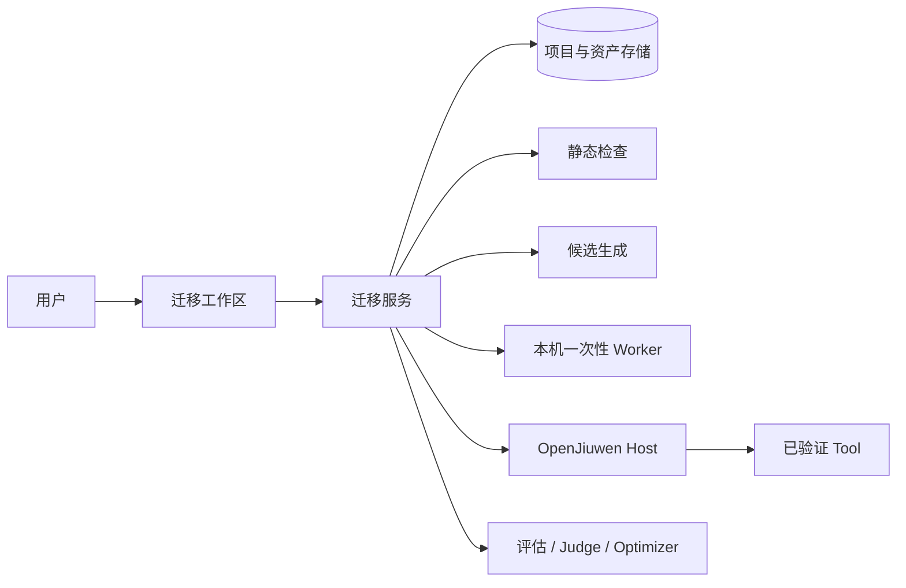
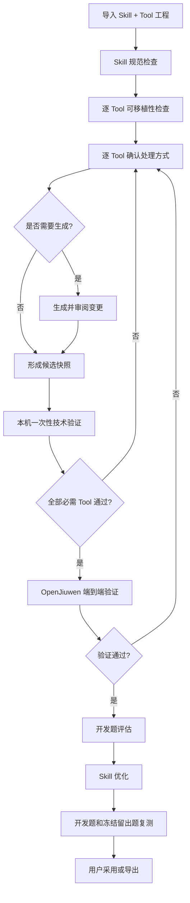

# Finance Skill Eval 2.0：整体架构（L0）

> 对应 [GitHub Issue #3](https://github.com/bitlhk/finance-skill-eval/issues/3)。本文件描述系统边界和关键决策；用户特性及验收要求见 [features.md](./features.md)。

## 1. 架构结论

**这是一个 Skill 评估产品。** 它交付的是"这个 Skill 好不好、以及改到更好之后确实变好了"的结论。Skill 标准化与 Tool 迁移是第一阶段——不是产品本体，是让评估得以成立的前置。

系统分两阶段：

| 阶段 | 定位 | 出口 |
| --- | --- | --- |
| **A 准入门槛** | 让资产达到"能被正确加载、工具接口没坏" | 代码符合源契约 + Skill 合规可加载。全确定性，不需要人评判——它回答"能不能用" |
| **B 评估** | 产品本体 | 回答"好不好用" |

2.0 的改造目标不是把一个 Runtime 的代码机械翻译成另一个 Runtime 的代码，而是让 Skill 和 Tool 成为可以分别检查、迁移和验证的资产。

- Skill 保存业务方法，遵守独立的企业 Skill 规范；
- Tool 提供实际能力，可以独立于 Agent Runtime 运行和测试；
- 迁移工作区按 Tool 判断可移植性，并为每个 Tool 分别制定处理方式；
- 已经可移植的 Tool 保留原实现，不因语言不同而重写；
- 需要迁移的 Tool 可以转换为 MCP Tool 或 Script Tool；
- 首期在本机执行一次性技术验证（阶段 A 出口），OpenJiuwen 端到端验证与评估归阶段 B；
- 企业工作站是首期交付环境，Windows 必须提供不依赖 Bash 或 systemd 的本地启动入口；
- 通过验证后复用现有评估、Judge、Optimizer 和留出题能力。

## 2. 已确认的设计决策

| 主题 | 决策 |
| --- | --- |
| 迁移粒度 | 按 Tool 决策；同一项目允许采用不同处理方式 |
| Skill | 原则上保留业务内容，只检查规范和必要的 Tool 引用 |
| MCP 协议 | 协议与语言无关；已有合规 MCP 不限实现语言 |
| 生成语言判据 | **同语言优先**：源语言可用就用源语言；否则按生态最接近的选；仍无倾向 → MCP 用 Java、Script 用 Python。跨语言重写**允许，但计划里必须提示不推荐** |
| 源语言支持范围 | **Java / Python / JavaScript**。其余（Go、C# 等）标 `UNSUPPORTED`，不自动迁移，交人工 |
| MCP 生成语言 | **不限制 Java**。按输入 Tool 代码判断：同语言，或便于转换的语言 |
| Script 生成语言 | **Python / Node**（不加 Bash——两者能力已覆盖 Bash 场景） |
| 形式与语言归属 | 形式（MCP / Script）由**人工**定；语言由**系统**建议、**人工可选**覆盖 |
| 分析产出 | **对 Skill 的分析**：用到了哪些工具、每个工具的输入输出、样例。它既是**基线**（迁移要保留什么、校验拿什么比），也是**出题的种子** |
| 迁移判据 | 迁移保留**分析读出来的输入输出**。它来自分析，不是模型即席产出；但迁移**必然要做适配**（去 runtime 耦合、改调用方式），所以**不要求逐字不变** |
| 分析 → 迁移的传递 | 只传三样：**人的决定（形式、语言）+ 基线（工具、输入输出、样例）+ 源码**。**不传平台的分类判断**（可移植性状态、`kind`、findings、evidence）——那些是给授权环节的人做决定的，喂给 agent 只会让它照着标签走 |
| MCP 服务由谁生成 | **agent 生成全部代码**，含服务外壳与启动方式。平台**既不生成也不往工作区播种**；模板作为**指导**放在技能包 `references/` 里 |
| 交付物内容 | 代码 + **启动命令** + 接口改动理由 + README。启动命令由 agent 给——代码是它写的，它知道怎么起；平台据此起服务做校验 |
| 校验门禁 | 硬门禁只有三条：**起得来、工具有、调得通**。接口相对基线的差异是**报告**，不是门禁 |
| 迁移验收措辞 | 只写「**接口未见显著变化，且在生成的测试集上通过**」。**不写"迁移前后效果一致"**——runtime 绑定的源跑不了，"等价"没有强证据 |
| 测试集 | 从分析**生成**（复用平台已有的出题能力），用于验证迁移后。理想是同一批跑前后；只有能独立跑的源（`PORTABLE_SCRIPT` / `PORTABLE_MCP`）才可能真跑原始 |
| 迁移计划 | 规则的，且是（检查结果 + 人工决策）的纯函数 → 不独立成步，按需派生 |
| 扫描器定位 | 不是必经前置，是诊断 agent 可调用的工具之一；保留它是为了**覆盖率**——它能回答 agent 回答不了的"我漏了什么" |
| 人工介入 | 人工只出现在**授权**处（批准某个 Tool 可以被重写）；评判全部自动 |
| agent 实现载体 | 用 OpenJiuwen `harness` 的 `explore_agent` / `code_agent`。不自己写循环，也不引入第三方 agent 框架 |
| agent 终态 | 用框架的完成信号（`TaskCompletionRail` + `<promise>`）。结构化产出与弃权都在**最终输出**里，不新增提交工具 |
| 工具集 | 复用框架的文件/搜索/代码工具；自定义只加领域工具（扫描器、编译、契约测试）。**不给通用 shell** |
| 规范提供方式 | 企业规范（合规 + 可移植性判据 + 迁移建议）打包为**框架技能包**，agent 按需读取，不塞进系统提示 |
| 判据落点 | **机械可验的判据留在代码**（Schema 提取、行号校验、覆盖率、摘要绑定）；**判断类规则放进技能包** |
| 运行时实现 | **统一为 Python**：A2 agent、A4 agent、最终验证 runtime 全部是 openjiuwen-python |
| Java 参考 Host | **降级为测试夹具**，不再接产品验证路径。它是 runtime 耦合件，不能用来验证"脱离 runtime 耦合" |
| 环境隔离 | **平台环境与 Skill 包环境相互隔离**：各自声明、各自解析，谁都不用对方的解释器或依赖解析结果。边界按「是不是 Skill 包」划——**验收夹具包与迁移交付包同属一边**，不按流程步骤划 |
| 版本来源 | **平台环境**的单一来源 = `integrations/openjiuwen/uv.lock`，文档、提示词、代码都不硬编码版本号。**Skill 包**的依赖由该包自己声明（`pyproject.toml` / `package.json` / `pom.xml` / PEP 723），平台不代它决定 |
| Tool 信息 | 由**分析**产出，不靠"捞"。不再从散文里扫反引号、不靠正则从源码刨 `inputSchema` 字面量、不靠模型凭空填 Schema——那三样都是在找一个源里未必存在的东西 |
| Worker | 首期仅考虑本机一次性任务，不设计生产 Worker 平台 |
| 代码信任 | 首期输入为企业内部可信源码；本机 Worker 是任务边界，不宣称是不可信代码安全沙箱 |
| 最终 Runtime | 首期只接 OpenJiuwen 做端到端验证 |
| 0.1 兼容 | 保留历史读取和导出，旧验证结论不自动升级为 2.0 结论 |

### 2.1 已否决的设计

以下方案经过讨论被否决，不应重新引入。

| 方案 | 否决理由 |
| --- | --- |
| 假设源工程自带可运行测试 | 不现实——源工程一般不给测试数据 |
| 让模型自写冒烟输入当门禁判据 | 出题人、答题人、判卷人是同一个。循环会收敛到"通过了自己出的题"，而不是行为正确 |
| MCP 首期写死 Java | 跨语言重写损失保真度，且成本远高于同语言迁移 |
| 无判据时仍自动迁移 | 工具行为未被判定，阶段 B 的评估失去意义——分不清是 Skill 差还是 Tool 坏 |
| 阶段 A 拆成九步 | 过细；收成四步 |
| 独立的人工「专业复核」环节 | 若只复核技术正确性，与阶段 A 的自动验证重复 |
| 用工作流 + 模型单次调用贯穿全流程 | 探索型任务（诊断、生成、优化）需要 agent 循环；但控制流仍固定，agent 不决定步骤 |
| 自己写 agent 循环 | 轮数/时长预算、事件流、工具分发框架都已经有，重写不划算 |
| 引入第三方 agent 框架（LangGraph / LangChain / Vercel AI SDK 等） | 目标 Runtime 自带的 `harness` 已提供完整 code agent，再引一层只会增加错配 |
| 给 agent 通用 shell | 离散工具（read/write/edit/grep/glob/skill）参数结构化、trace 可读、权限可粒度控制；shell 全都拿不到。框架的 `search_via_bash` 默认即为 `False` |
| 用工具调用表达终态（弃权 / 提交） | 弃权是终态不是动作；且框架的 `wrap()` 吞掉工具异常，工具无法提前终止循环。用框架的完成信号 |
| 把行号校验这类机械判据写进技能包 | 提示词是软约束，模型可以不遵守；能机械验证的必须留在代码里 |
| 用 runtime 耦合的参考 Host 做端到端验证 | 它装自己的合成 Tool、从不执行上传产物，只能证明"宿主能跑宿主的工具"。一个耦合件证明不了去耦合 |
| 让 Java 与 Python 两侧保持同版本 | Java 侧只是夹具，不参与版本策略。强行让字符串相等会把夹具拖进运行时的升级节奏 |
| 依赖 `SysOperationRail(read_only=True)` 做只读 | 它只摘掉 write/edit，bash 照旧注入；要只读只能自己装配工具集 |
| 平台生成 MCP 服务脚手架并播种进 A4 工作区 | 把 agent 的闭环掐了一半：它只能填平台挖好的那个洞，不能自己搭服务、自己决定怎么起。而且服务公布的 Schema 变成"平台猜出来的那个"，不是"源里那个"。模板应当是**指导**，不是**产物** |
| 让模型交一段启动命令之外的自由命令/脚本 | 启动方式由 agent 声明是合理的（代码是它写的）；但平台要执行它。声明成**命令**、由平台控制执行方式（cwd、超时、输出），而不是让模型交一个平台照跑的东西 |
| 拿基线 Schema 逐字卡迁移结果 | 迁移必然做适配，逐字一致做不到也不该要求；那是拿基线当法律。基线是用来**看漂了多少**的 |
| 在验收里写"迁移前后效果一致" | runtime 绑定的源跑不了，没有等价的强证据。只能写"接口未见显著变化 + 测试集通过" |

### 2.2 待定的设计

以下尚未定案，实现前必须先定。

| 项 | 缺口 | 影响 |
| --- | --- | --- |
| A2 的轮数预算取值 | 机制已定（`MaxRoundsEvaluator`），具体数值未定 | 仅配置 |
| A4 循环的轮数 / 时长上限 | 同上 | 仅配置 |
| Java 参考 Host 的代码去留 | 已定"降级为测试夹具、不接产品路径"，但代码是删是留未定 | 仓库结构与 CI |
| `verifyTarget` / `MigrationTargetRuns` 的代码去留 | 已定"摘掉产品地位"，代码去留未定 | legacy 路径 |
| 阶段 B 的整体设计 | 评估层 2.0 只被改动 41 行 + 1 个新文件（集中在候选评估模式），核心 A/B 盲评、Optimizer、冻结留出题未动 | 阶段 B 全部 |
| MCP 候选的端到端路径（阶段 B） | `runtimeToolBindings` 只筛 `kind === 'SCRIPT'`，MCP 候选没有 E2E 验证 | 阶段 B 的验收前提 |

## 3. 目标与非目标

### 3.1 首期目标

- 导入包含一个 Skill 以及相关 Tool 源码、资源和依赖声明的工程；
- 分别展示 Skill 规范问题和每个 Tool 的可移植性结果；
- 为每个 Tool 选择保留、迁移为 MCP、迁移为 Script 或人工处理；
- 保持原始资产不可变，所有生成内容形成新候选并提供 Diff；
- 对已有或生成的 Tool 运行本机一次性技术验证；
- 在 OpenJiuwen 中加载当前 Skill 和已验证 Tool，执行声明式测试；
- 复用现有评估和优化闭环，且 Optimizer 不修改已经验证的 Tool；
- 导出候选、测试结果和验证摘要。

### 3.2 首期非目标

- 不自动补造缺失的业务实现或权威 Schema；
- 不证明迁移前后的 Runtime 完全等价；
- 不执行自动生产发布；
- 不支持有真实外部副作用的 Tool 自动办理业务；
- 不建设远程 Worker、任务签名、生产凭据注入或集群调度；
- 不提供 OpenJiuwen 之外的最终 Runtime 验证；
- 不承诺自动迁移任意语言和任意框架。

## 4. 系统上下文

| 模块 | 主要职责 | 明确不做的事情 |
| --- | --- | --- |
| 迁移工作区 | 展示检查结果、逐 Tool 决策、候选 Diff 和验证状态 | 不解释源代码为业务事实 |
| 迁移服务 | 保存项目状态、编排检查、生成和验证 | 不把产品支持范围写成 Skill 标准 |
| 静态检查 | 读取文件并提取可验证证据 | 不导入或执行上传代码 |
| 候选生成 | 生成可审阅的新文件 | 不修改原始资产，不补造业务实现 |
| 本机 Worker | 在临时目录执行一次技术验证并清理 | 不宣称具备生产安全隔离能力 |
| OpenJiuwen Host | 装配 Skill 和 Tool，返回真实运行证据 | 不负责构建上传工程 |
| 评估优化 | 比较结果并优化 Skill | 不修改已验证 Tool |

## 5. 核心流程

检查、迁移和验证都是逐 Tool 进行，项目状态由所有必需 Tool 的当前状态汇总，不再要求整个项目只能选择一种迁移方式。

## 6. Skill 检查

Skill 检查以企业 Skill 规范为依据，至少包括：

- 是否存在且仅存在一个 `SKILL.md`；
- frontmatter 中 `name` 和 `description` 是否符合 Agent Skills 规则；
- 引用的相对文件是否存在；
- Tool 名称和使用时机是否能够理解；
- 是否含硬编码凭据、机器专用绝对路径或 Runtime 专用业务步骤；
- 是否说明信息不足、失败和拒绝时的处理方法。

Skill 检查结果只说明文档是否符合规范，不负责判断 Tool 是否能够运行。

## 7. Tool 发现与可移植性

发现 Tool 靠**分析**，不靠"捞"。分析回答三个问题：

1. 这个 Skill 用到了哪些工具；
2. 每个工具的输入输出是什么；
3. 样例是什么。

它同时是**基线**（迁移保留什么、校验比什么）与**出题的种子**。

**不采用**的做法：扫散文里的反引号当 Tool 名、正则从源码刨 `inputSchema` 字面量、让模型凭空填一个 Schema。这三样都在找一个**源里未必存在**的东西——runtime 绑定的工具本来就没有"声明的 Schema"，形状只活在代码和文档里。

分析结果落在**证据**上：每条都要能指到真实的文件与行。落不到源码/文档上的主张不成立。

每个 Tool 使用以下静态状态：

| 状态 | 含义 |
| --- | --- |
| `PORTABLE_MCP` | 有证据表明它是可独立运行的 MCP Tool |
| `PORTABLE_SCRIPT` | 有证据表明它是可独立运行的命令行 Tool |
| `RUNTIME_BOUND` | 业务实现存在，但调用方式依赖源 Runtime SDK |
| `INCOMPLETE` | 业务实现、输入输出或必要依赖不完整 |
| `UNSUPPORTED` | 当前平台不能自动处理这种实现 |
| `UNKNOWN` | 证据不足或检查未完成 |

静态状态不是验证结果。迁移工作区面向需要改造的 Skill，每个被发现的 Tool 都需要选择目标提供方式。

除静态状态外，平台还为每个 Tool 给出**建议形式**（MCP / Script）与**建议语言**（按 §2 的生成语言判据算出）。建议供人工在阶段 A 的授权环节参考，不代替人工决定。人工若选了会导致跨语言重写的形式，计划里必须提示不推荐。

## 8. 逐 Tool 迁移决策

这是阶段 A 的**授权**环节。每个 Tool 独立选择形式：

| 形式 | 用途 |
| --- | --- |
| `MCP` | 生成或接入 MCP Tool 候选 |
| `SCRIPT` | 生成或接入 Script Tool 候选 |

- **形式必选**：每个 Tool 必须选择 MCP 或 Script，选择 MCP 的多个 Tool **按实现语言**统一放入各自的 MCP 服务中（每种语言一个）；
- **语言可选**：不填则采用平台的建议语言；
- 不需要填写理由。

人工在这里做的是**授权**，不是技术评判——"这个 Tool 的业务行为允不允许脱离原系统运行"是合规与风控问题，系统没有依据可判断。因此平台只能给出建议，不能替用户作出授权决定，也不能把 `UNKNOWN` 自动当成 `KEEP`。而"选哪种形式更可行"属于工程判断，平台应当给出建议。

## 9. 候选生成

- 生成操作基于精确的源资产摘要；
- 原始 ZIP 和已保存版本保持不可变；
- 每个生成文件标明来源 Tool 和生成方式；
- 已有合规实现原样保留；
- **代码由 agent 生成，平台不生成**：服务外壳、适配器、启动方式都在 agent 的交付里。模板与示例放在技能包 `references/` 里当指导；
- 每个 Skill **每种目标语言最多生成一个** MCP 服务工程（`mcp-java/` / `mcp-python/` / `mcp-node/`），同语言的多个 MCP Tool 在该服务内统一注册。两种语言不能共用一个进程，而强迫其中一种跨语言重写又违背同语言优先的判据；
- **MCP 生成语言不写死**：按 §2 的生成语言判据算出（同语言优先）。跨语言重写允许，但计划里必须提示不推荐；
- **Script 生成语言为 Python 或 Node**；
- 生成是一个**循环**，不是单次动作：生成 → 起服务 → 契约测试 → 失败原因回灌 → 再生成。出口为全部通过、agent 判定无法忠实迁移（弃权）、或预算耗尽；
- 交付物包含**启动命令**——代码是 agent 写的，怎么起由它说明，平台据此起服务；
- **运行在 Skill 包自己的环境里**（见 §2 环境隔离），不是 agent 的环境；
- Skill 不记录环境安装步骤，运行环境由 Tool 工程和本机 Worker 准备。

## 10. 本机一次性 Worker

首期 Worker 是迁移服务调用的本机任务执行器：

1. 为一次验证创建新的临时目录；
2. 只写入本次候选所需文件；
3. 使用固定程序和参数启动构建或测试；
4. 设置超时并限制输出大小；
5. 取消时终止任务进程；
6. 收集退出码、标准输出、错误输出和阶段结果；
7. 任务结束后清理临时目录。

首期只接受企业内部可信源码。界面和报告必须明确显示 `LOCAL_TRUSTED`，不得把它描述为安全沙箱或生产隔离验证。

## 11. 验证分层

阶段 A 的出口由确定性验证构成，不需要人评判。

### 11.1 契约测试

**硬门禁三条，只有三条：起得来、工具有、调得通。**

- MCP Tool：能启动，`tools/list` 里有目标 Tool，`tools/call` 能返回；
- Script Tool：入口能执行，输入能解析、输出能解析、退出码正确。

**接口相对基线的差异是报告，不是门禁。** 迁移必然要做适配（去 runtime 耦合、改调用方式），逐字一致做不到，也不该要求。所以记录：

- 迁移前的入参出参（基线，来自 §7 的分析）；
- 迁移后的入参出参；
- **每处差异的理由**（由 agent 在交付时给出）。

差异越小越好，但**有理由的改动是正常的**。逐字卡一致性等于拿基线当法律——而基线本身是从五花八门的源里读出来的。

### 11.2 Tool 技术验证

MCP Tool 至少验证：启动、`initialize`、`tools/list`、目标 `tools/call`、错误返回、超时和停止。

Script Tool 至少验证：入口可执行、输入输出可解析、错误返回、退出码、超时和日志边界。

**技术验证在 Skill 包自己的环境里跑**（§2 环境隔离），启动方式用交付物声明的启动命令。

技术验证绑定候选资产和 Tool ID。候选变化后，对应结果自动失效。

### 11.3 OpenJiuwen 端到端验证（阶段 B）

OpenJiuwen Host 加载当前 Skill，连接已经通过技术验证的 Tool，并运行项目测试用例。Agent 可以自主选择 Tool 和调用顺序；断言只检查必要能力、业务结果和必要的安全先后关系。

端到端验证判定的是 **Skill 与 Tool 合起来能否完成任务**，属于能力评价，因此归阶段 B，不计入阶段 A 的准入门槛。

验证证据至少记录 Skill、Tool、Runtime、模型、测试用例和实际 Tool 调用。任何绑定内容发生变化，相应验证结果失效。

## 12. 评估与优化

- B：迁移完成后的 Skill + 已验证 Tool；
- C：优化后的 Skill + 同一组已验证 Tool。

B/C 比较保持 Runtime、模型、数据和权限条件一致，只评价 Skill 的改进。Optimizer 只能修改 `SKILL.md` 和明确允许的非执行业务资源；不得修改 Tool 源码、依赖和测试，也不得读取冻结留出题。

## 13. 0.1 兼容

- 继续读取 0.1 项目、源资产、候选、Diff、评测、优化和复核历史；
- 旧生成目录和报告可以查看、导出；
- 旧 `simulationProfile` 和 `targetRuns.PASSED` 只作为历史证据展示；
- 旧项目进入 2.0 流程时重新进行 Skill/Tool 检查和当前资产验证；
- 新项目使用 2.0 模型，旧 API 只保留必要的读取适配，不继续扩大旧写入语义。

## 14. 交付顺序

阶段 A（准入门槛）：

1. 项目模型、Skill 检查、Tool 检查和逐 Tool 授权；
2. MCP（按源 Tool 语言）与 Script（Python / Node）两种生成切片；
3. 生成循环：编译 + 契约测试 + 加载检查，失败原因回灌；
4. 本机技术验证。

阶段 B（评估）：

5. OpenJiuwen 端到端验证；
6. 评估、优化、报告和导出闭环；
7. 前端完成全流程并补齐回归测试。

每个切片都必须包含正例、缺失实现负例、资产变化导致验证失效的用例。

## 15. 完成标准

2.0 是否完成，以 `features.md` 中所有首期特性的验收标准为准，而不是以模块或接口数量为准。
