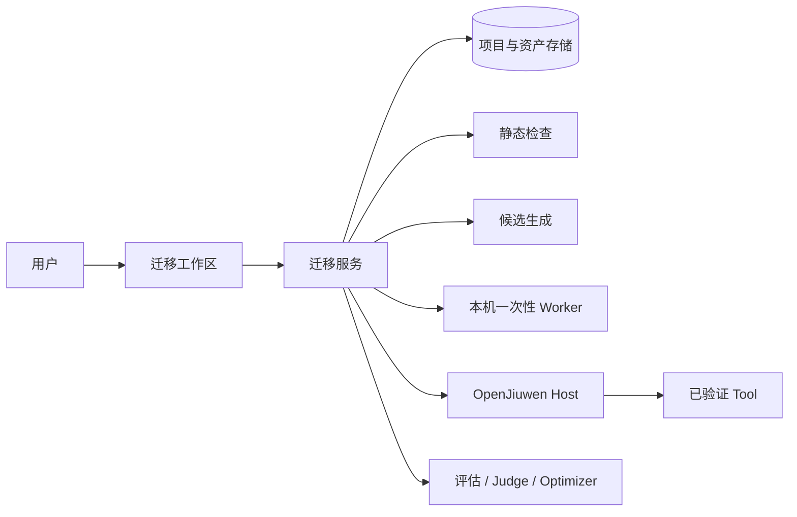
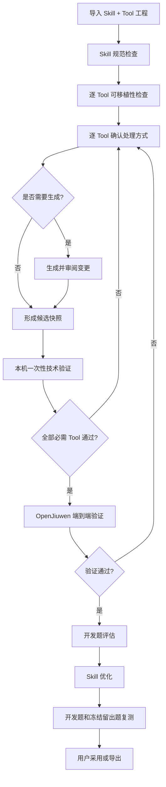

# Finance Skill Eval 2.0：整体架构（L0）

> 对应 [GitHub Issue #3](https://github.com/bitlhk/finance-skill-eval/issues/3)。本文件描述系统边界和关键决策；用户特性及验收要求见 [features.md](./features.md)。

## 1. 架构结论

2.0 的改造目标不是把一个 Runtime 的代码机械翻译成另一个 Runtime 的代码，而是让 Skill 和 Tool 成为可以分别检查、迁移和验证的资产。

- Skill 保存业务方法，遵守独立的企业 Skill 规范；
- Tool 提供实际能力，可以独立于 Agent Runtime 运行和测试；
- 迁移工作区按 Tool 判断可移植性，并为每个 Tool 分别制定处理方式；
- 已经可移植的 Tool 保留原实现，不因语言不同而重写；
- 需要迁移的 Tool 可以转换为 MCP Tool 或 Script Tool；
- 首期在本机执行一次性技术验证，再使用 OpenJiuwen 完成端到端验证；
- 企业工作站是首期交付环境，Windows 必须提供不依赖 Bash 或 systemd 的本地启动入口；
- 通过验证后复用现有评估、Judge、Optimizer 和留出题能力。

## 2. 已确认的设计决策

| 主题 | 决策 |
| --- | --- |
| 迁移粒度 | 按 Tool 决策；同一项目允许采用不同处理方式 |
| Skill | 原则上保留业务内容，只检查规范和必要的 Tool 引用 |
| MCP | 协议与语言无关；已有合规 MCP 不限实现语言 |
| Script | 脚本语言不作标准限制；首期自动生成优先支持 Python |
| 自动生成 | 首期可以生成 Java 实现的 MCP Tool 和 Python Script Tool，这是产品能力范围，不是合规标准 |
| Tool 信息 | 平台从 MCP 自描述、脚本工程、依赖文件和源码中提取；不要求 Skill 增加专用 Tool 清单 |
| Worker | 首期仅考虑本机一次性任务，不设计生产 Worker 平台 |
| 代码信任 | 首期输入为企业内部可信源码；本机 Worker 是任务边界，不宣称是不可信代码安全沙箱 |
| 最终 Runtime | 首期只接 OpenJiuwen 做端到端验证 |
| 0.1 兼容 | 保留历史读取和导出，旧验证结论不自动升级为 2.0 结论 |

## 3. 目标与非目标

### 3.1 首期目标

- 导入包含一个 Skill 以及相关 Tool 源码、资源和依赖声明的工程；
- 分别展示 Skill 规范问题和每个 Tool 的可移植性结果；
- 为每个 Tool 选择保留、迁移为 MCP、迁移为 Script 或人工处理；
- 保持原始资产不可变，所有生成内容形成新候选并提供 Diff；
- 对已有或生成的 Tool 运行本机一次性技术验证；
- 在 OpenJiuwen 中加载当前 Skill 和已验证 Tool，执行声明式测试；
- 复用现有评估和优化闭环，且 Optimizer 不修改已经验证的 Tool；
- 导出候选、测试结果和验证摘要。

### 3.2 首期非目标

- 不自动补造缺失的业务实现或权威 Schema；
- 不证明迁移前后的 Runtime 完全等价；
- 不执行自动生产发布；
- 不支持有真实外部副作用的 Tool 自动办理业务；
- 不建设远程 Worker、任务签名、生产凭据注入或集群调度；
- 不提供 OpenJiuwen 之外的最终 Runtime 验证；
- 不承诺自动迁移任意语言和任意框架。

## 4. 系统上下文

| 模块 | 主要职责 | 明确不做的事情 |
| --- | --- | --- |
| 迁移工作区 | 展示检查结果、逐 Tool 决策、候选 Diff 和验证状态 | 不解释源代码为业务事实 |
| 迁移服务 | 保存项目状态、编排检查、生成和验证 | 不把产品支持范围写成 Skill 标准 |
| 静态检查 | 读取文件并提取可验证证据 | 不导入或执行上传代码 |
| 候选生成 | 生成可审阅的新文件 | 不修改原始资产，不补造业务实现 |
| 本机 Worker | 在临时目录执行一次技术验证并清理 | 不宣称具备生产安全隔离能力 |
| OpenJiuwen Host | 装配 Skill 和 Tool，返回真实运行证据 | 不负责构建上传工程 |
| 评估优化 | 比较结果并优化 Skill | 不修改已验证 Tool |

## 5. 核心流程

检查、迁移和验证都是逐 Tool 进行，项目状态由所有必需 Tool 的当前状态汇总，不再要求整个项目只能选择一种迁移方式。

## 6. Skill 检查

Skill 检查以企业 Skill 规范为依据，至少包括：

- 是否存在且仅存在一个 `SKILL.md`；
- frontmatter 中 `name` 和 `description` 是否符合 Agent Skills 规则；
- 引用的相对文件是否存在；
- Tool 名称和使用时机是否能够理解；
- 是否含硬编码凭据、机器专用绝对路径或 Runtime 专用业务步骤；
- 是否说明信息不足、失败和拒绝时的处理方法。

Skill 检查结果只说明文档是否符合规范，不负责判断 Tool 是否能够运行。

## 7. Tool 发现与可移植性

平台综合以下证据发现 Tool：

1. MCP 的 `tools/list` 或可静态读取的 MCP 声明；
2. `SKILL.md` 中明确提到的 Tool；
3. Python、Java 等源码中的 Tool 注册和业务入口；
4. 脚本入口、依赖文件和已有测试；
5. 用户补充的确认信息。

每个 Tool 使用以下静态状态：

| 状态 | 含义 |
| --- | --- |
| `PORTABLE_MCP` | 有证据表明它是可独立运行的 MCP Tool |
| `PORTABLE_SCRIPT` | 有证据表明它是可独立运行的命令行 Tool |
| `RUNTIME_BOUND` | 业务实现存在，但调用方式依赖源 Runtime SDK |
| `INCOMPLETE` | 业务实现、输入输出或必要依赖不完整 |
| `UNSUPPORTED` | 当前平台不能自动处理这种实现 |
| `UNKNOWN` | 证据不足或检查未完成 |

静态状态不是验证结果。迁移工作区面向需要改造的 Skill，每个被发现的 Tool 都需要选择目标提供方式。

## 8. 逐 Tool 迁移决策

每个 Tool 独立选择一个动作：

| 动作 | 用途 |
| --- | --- |
| `MIGRATE_TO_MCP` | 生成或接入 MCP Tool 候选 |
| `MIGRATE_TO_SCRIPT` | 生成或接入 Script Tool 候选 |

用户只选择每个 Tool 使用 MCP 还是 Script，不需要填写理由。选择 MCP 的多个 Tool 统一放入当前 Skill 的一个 MCP 服务中。

平台可以根据检查结果给出建议，但不能替用户作出业务授权决定，也不能把 `UNKNOWN` 自动当成 `KEEP`。

## 9. 候选生成

- 生成操作基于精确的源资产摘要；
- 原始 ZIP 和已保存版本保持不可变；
- 每个生成文件标明来源 Tool 和生成方式；
- 已有合规实现原样保留；
- Schema 或业务实现缺失时只生成待办和骨架，候选不能通过技术验证；
- 首期 MCP 自动生成器输出 Java 工程；
- 每个 Skill 最多生成一个 MCP 服务工程，多个 MCP Tool 在该服务内统一注册；
- 首期 Script 自动生成器输出带 `pyproject.toml` 和 `uv.lock` 的 Python 工程；
- Skill 不记录环境安装步骤，运行环境由 Tool 工程和本机 Worker 准备。

## 10. 本机一次性 Worker

首期 Worker 是迁移服务调用的本机任务执行器：

1. 为一次验证创建新的临时目录；
2. 只写入本次候选所需文件；
3. 使用固定程序和参数启动构建或测试；
4. 设置超时并限制输出大小；
5. 取消时终止任务进程；
6. 收集退出码、标准输出、错误输出和阶段结果；
7. 任务结束后清理临时目录。

首期只接受企业内部可信源码。界面和报告必须明确显示 `LOCAL_TRUSTED`，不得把它描述为安全沙箱或生产隔离验证。

## 11. 两层验证

### 11.1 Tool 技术验证

MCP Tool 至少验证：启动、`initialize`、`tools/list`、目标 `tools/call`、错误返回、超时和停止。

Script Tool 至少验证：入口可执行、输入输出可解析、错误返回、退出码、超时和日志边界。

技术验证绑定候选资产和 Tool ID。候选变化后，对应结果自动失效。

### 11.2 OpenJiuwen 端到端验证

OpenJiuwen Host 加载当前 Skill，连接已经通过技术验证的 Tool，并运行项目测试用例。Agent 可以自主选择 Tool 和调用顺序；断言只检查必要能力、业务结果和必要的安全先后关系。

验证证据至少记录 Skill、Tool、Runtime、模型、测试用例和实际 Tool 调用。任何绑定内容发生变化，相应验证结果失效。

## 12. 评估与优化

- B：迁移完成后的 Skill + 已验证 Tool；
- C：优化后的 Skill + 同一组已验证 Tool。

B/C 比较保持 Runtime、模型、数据和权限条件一致，只评价 Skill 的改进。Optimizer 只能修改 `SKILL.md` 和明确允许的非执行业务资源；不得修改 Tool 源码、依赖和测试，也不得读取冻结留出题。

## 13. 0.1 兼容

- 继续读取 0.1 项目、源资产、候选、Diff、评测、优化和复核历史；
- 旧生成目录和报告可以查看、导出；
- 旧 `simulationProfile` 和 `targetRuns.PASSED` 只作为历史证据展示；
- 旧项目进入 2.0 流程时重新进行 Skill/Tool 检查和当前资产验证；
- 新项目使用 2.0 模型，旧 API 只保留必要的读取适配，不继续扩大旧写入语义。

## 14. 交付顺序

1. 2.0 项目模型、Skill 检查、Tool 检查和逐 Tool 决策；
2. Java MCP 与 Python Script 两种生成切片；
3. 多个 MCP Tool 合并为一个 MCP 服务并完成本机技术验证；
4. OpenJiuwen 端到端验证；
5. 评估、优化、报告和导出闭环；
6. 前端完成全流程并补齐回归测试。

每个切片都必须包含正例、缺失实现负例、资产变化导致验证失效的用例。

## 15. 完成标准

2.0 是否完成，以 `features.md` 中所有首期特性的验收标准为准，而不是以模块或接口数量为准。
