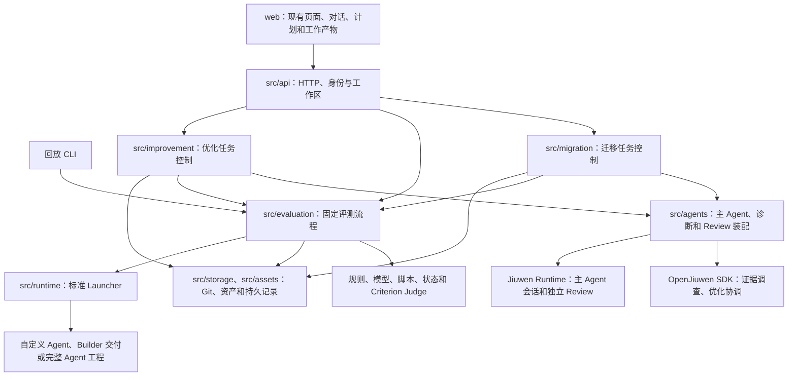

# 当前代码架构

后端是 Python，前端是 TypeScript/React。旧 npm 编程接口已撤销，平台通过 HTTP/SSE 提供服务，保留原命令行入口。没有 TypeScript 后端或平台能力进程桥。

## 三个业务入口

**迁移**：`api/migration_routes.py → migration/service.py → migration/execution.py`。控制器处理任务、幂等、恢复和用户交互；`agents/migration.py` 通过 HTTP 调用 Jiuwen Runtime 中的主 Agent。Agent 根据目标主动加载 Skill 和工具，读取工程、分析、调整、验证、请求独立 Review，并更新对话和工作产物。

基础验证使用工程执行、`improvement/basic_review.py` 和 `evaluation/checks.py`，确保选择迁移的能力完整、可运行；效果验证由 `migration/acceptance_service.py` 接入统一评测。源码、Skill、随包工具和运行配置都是可能的调整对象。Builder 属于主 Agent 可使用的外部构建能力；新建与重建的请求和等待记录保留，外部服务缺失不会被当成构建成功。

主 Agent 用 `request_development_evaluation({})` 请求一次效果评测；用户明确给出目标和预算时才用 `request_optimization` 启动持续优化。两个工具共用评测提交与续接逻辑，不要求一次普通验证先提供优化基线。长任务由模型调用超时、工程命令超时、Agent 迭代预算及用户暂停/取消控制，HTTP 订阅不另设与业务无关的十五分钟截止时间。

`request_effect_review` 也支持两种目标：只提供当前 runId 时，按用户目标审查单次测试结果；提供真实 baseline runId 时，比较候选的改善与回退。两种模式共用同一个独立 Review Agent、证据查询和交付检查。单次目标审查不保存虚构基线，不宣称提升；持续优化仍必须保留真实比较基线。基础验证与效果验证均通过对应审查后，原下载入口提供完整验收交付包。

**对比评测**：`api/run_routes.py → evaluation/service.py → job_execution.py / comparison.py`。这是固定程序，按用户选择冻结数据与配置，再运行、判定和报告。生成优化候选时才进入优化能力。重复业务运行会再次调用被测 Agent；重新评分只读取保存的证据。

**独立优化**：`api/improvement_routes.py → improvement/service.py → agents/optimization.py`。OpenJiuwen 优化协调 Agent 选择诊断、调整、复测、Review 等工具。`improvement/engineering.py` 调用同一个工程主 Agent；`agents/review.py` 为迁移与独立优化提供同一独立 Review 适配。选版规则在 `improvement/policy.py`，支持 Review 权衡回退、继续修复当前版本，以及在预算结束时呈现已审查的推荐结果。

## 公共能力与边界

| 能力 | 代码 | 边界 |
| --- | --- | --- |
| HTTP、认证和工作区 | `api/server.py`、`api/identity.py` | 沿用现有身份；不把会话 ID 当成权限 |
| 主 Agent / 独立 Review | `agents/migration.py`、`agents/review.py`、`runtime/agent_client.py` | 调用框架 Runtime 的持久会话 |
| 诊断与证据调查 | `agents/diagnosis.py`、`agents/model_roles.py` | 冻结材料、独立上下文、只读查询与调用预算 |
| 模型访问 | `runtime/models.py`、`integrations/openjiuwen/model_config.py` | 共用 OpenJiuwen SDK；不自建模型 HTTP 传输 |
| Launcher 与环境准入 | `runtime/launcher.py`、`runtime/environments.py` | 运行协议、证据、清理和能力准入，不替用户选择降级工具形式 |
| 执行和评测 | `evaluation/execution.py`、`orchestration.py`、`scoring.py` | 业务执行与验证器隔离；验证材料不注入被测任务 |
| 重评与人工校准 | `evaluation/rescoring.py`、`human_review.py` | 原证据不重跑，原报告不覆盖，分歧和旧标注可追溯 |
| 工程文件与资产 | `storage/git.py`、`assets/snapshot.py`、`assets/store.py` | 文件版本与资产保持原始字节；受保护文件不交给模型改写 |
| 并发与恢复 | `storage/coordination.py`、`storage/repository.py` | 共享目录下的执行归属、写入协调与恢复；不另造 Agent 实例调度 |

主 Agent 的 Prompt、指导 Skill 和参考材料只在 `src/resources/agents/`。框架运行适配在 `integrations/openjiuwen/`，包括会话隔离、检查点、上下文压缩、执行日志和 Runtime 实例调度。平台能力通过原子工具和 Skill 提供，需要独立上下文的工作交给子 Agent；不把每个自然语言阶段都变成强格式工作流。

交付审查子 Agent 复用已配置的 `JUDGE` 模型，未配置时才沿用主模型；调查子 Agent 继续使用主模型。主 Agent 可用 `query_delivery_tools` 查询登记状态，审查者在冻结材料中读取同一登记事实，无需用户确认平台内部是否已经登记。

答案质量 Judge 使用答案标准及允许的业务事实，采用明确的 0–4 分量表；过程标准由独立的执行证据核验处理。答案没有展示命令或日志，本身不能作为“没有实际调用工具”的证据。两类结果在汇总时共同决定是否满足测试要求。

## 部署与数据

默认 API 为 `56361`，主 Agent Runtime 为 `56363`，内置业务 Launcher 为 `56362`。业务 Launcher 也可以是企业远程服务。开发使用 `pnpm serve`、`pnpm serve:agent-runtime` 和按需的 `pnpm serve:openjiuwen`；API 本身不偷偷拉起另一套 Agent 服务。

多实例当前按共享持久目录部署，沿用 `data/`、账户工作区、任务记录、会话记录和 Git 工程。历史旧协议只读展示，不提供误导性的恢复操作。升级启动器会为旧资产导出经原摘要校验的排序元数据，不改写资产内容。

详细改造与验证口径见 [五步迁移记录](backend-five-step-migration.md)，开发命令见 [本地开发](local-development.md)。
