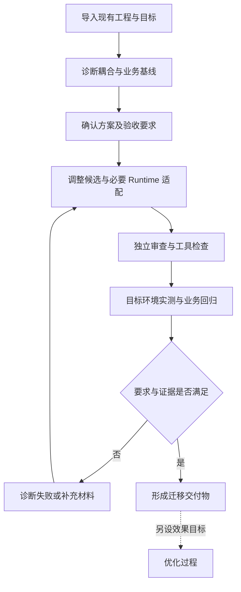
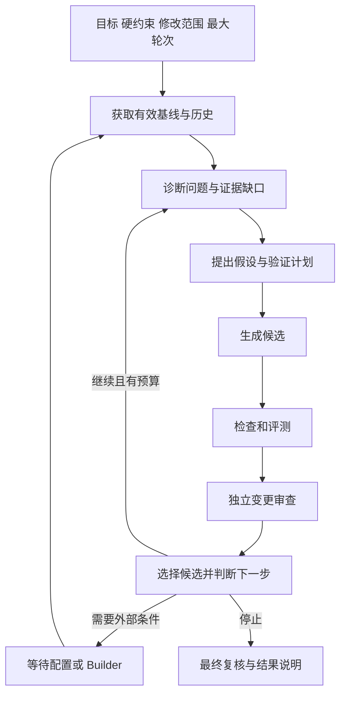

# 企业 Skill 平台方案

更新日期：2026 年 11 月 1 日。状态：待确认的整体设计，不表示下述扩展已经实现。实施映射与验收见[代码复用与分阶段改造计划](enterprise-skill-platform-refactoring-plan.md)。

## 改造目标与范围

项目同时进行基础能力重构和评测优化能力完善。重构覆盖前台、HTTP 接口、后台服务、内部调用、执行进程和存储，不依据代码新旧或页面是否显示判断是否保留。已有有效行为、权限约束、验证语义和后台依赖必须保留；重复实现逐项合并，确认没有调用或兼容用途且替代验证完成后才能删除。

完善以可组合、可扩展的评测与优化为目标。通过稳定接口覆盖不同任务、企业 Runtime、工具、验证方式和优化策略；新增方案优先增加实现和配置，不复制一条业务流程。协议无法提供的证据明确标记缺失，不能用默认成功扩大宣称的能力。

用户仍在现有的精选技能、对比评测、Skill 资产、Skill 迁移、测试环境、评测方法、运行记录中工作。保留视觉风格、左右对比和迁移七步；在原位置完善任务衔接、失败处理、优化及交付，不增加评测中心或助手团队管理入口。

## 场景与公共能力

评测、迁移和优化是三种业务过程。诊断、调整、执行、评估和审查是内部能力，两者不与页面或 Agent 数量一一对应。

| 过程 | 目标 | 完成后的产物 |
| --- | --- | --- |
| 评测 | 在明确条件下测量行为、质量、可靠性和成本 | 运行证据、逐项结果、达标判断、比较报告 |
| 迁移 | 按企业标准消除复用障碍并保持已确认的业务要求 | 标准化工程、必要 Runtime 适配、验证与交付记录 |
| 优化 | 在目标、范围和轮次预算内寻找更好的方案 | 候选历史、诊断与实验依据、最佳已验证方案及未达项 |

公共能力采用以下边界。它们是模块内的职责划分，不要求独立部署，也不强制全部使用 Agent。

| 公共能力 | 输入 | 输出与边界 |
| --- | --- | --- |
| 评测准备 | 目标、业务要求、任务来源、环境能力 | 版本化任务与验证计划；自动出题不能自动改动正式验收标准 |
| 执行与取证 | 固定方案、案例、环境、执行预算 | 轨迹、产物、状态变化、费用与异常；不评分、不修改候选 |
| 验证与评估 | 执行或静态检查材料、判据、证据访问权限 | 逐项结果与指标；支持单对象和直接双侧比较 |
| 诊断与规划 | 源码、要求、运行证据、实验历史 | 有证据的问题、归因、调整建议和验证计划；证据不足可弃权 |
| 候选改造 | 父版本、确认方案、允许修改范围 | 独立候选、差异及未完成项；文档、工具、工程和 Builder 分别授权 |
| 独立变更审查 | 原版、候选、方案、检查与运行证据 | 符合、需修改或证据不足；不能修补后冒充原候选通过 |
| 实验编排与选择 | 目标、预算、历史、各能力结果 | 下一动作、候选选择、等待状态与停止原因；不篡改评测事实 |

这些能力共用资产与证据底座。某项能力可以被页面请求调用，也可以被后台编排调用；所有路径遵循相同版本和权限规则。

## 三个过程的完整设计

### 评测过程


评测可以只运行一个方案，也可以比较多个方案。单次执行记录不以 left/right 为身份；现有 A/B 页面将方案映射为左右两侧。需要两份证据同时判断的 Pairwise Judge 保留，不强拆成两次独立评分。

运行事实、评测判断和诊断假设分别记录。工具未被完整观测不等于未调用，运行未完成不等于业务做错，Judge 故障不等于候选退化。诊断建议可以作为报告附件，但评测不会自行修改被测对象或自动启动优化。

### 迁移过程



迁移先提取并确认原业务行为、输入输出、错误与状态语义、部署条件和企业标准，再决定工具形式和改造范围。能运行原工程时，使用相同任务建立基线；不能运行时保留源码及要求依据，明确未获得实测对照的部分，不声称证明完整等价。

迁移验证包含源码与架构审查、Script/MCP 合同测试、目标 Runtime 实测、业务回归，以及方案要求的跨环境复用验收。按条件分层执行，不必每次代码编辑后立即跑全套昂贵业务测试；交付前必须满足全部适用门槛，检查跳过须有明确依据。

修复仍围绕已确认迁移要求。涉及新增部署依赖、业务权衡或改动目标时形成方案修订，重新确认并使相关验证失效。迁移标准化完成与后续效果目标达成分别记录。

### 优化过程



诊断贯穿每轮，允许复用有效的既有诊断并只更新受新证据影响的部分。诊断记录至少包含观察事实、归因层、证据引用、置信程度、改进假设、预期行为、风险和否定假设的验证办法。归因层覆盖 Skill、Tool、配置、Runtime、评测方案及未知原因，不预设所有问题都是文档问题。

不同归因进入不同分支：Skill 或工具缺陷进入候选改造；配置问题等待企业补充或经授权修改；Runtime 能力缺口进入 Builder；评测方案错误单独修订后重建可比基线；证据不足请求补充验证或弃权。运行服务故障先处理运行问题，不能直接推动业务代码改写。

默认一轮包含一次诊断、一个候选改造及其验证与选择。生成的无效候选、失败的已执行改造尝试也计入轮次，防止无限重试；单次调用内的格式修正不算新业务轮次。同一候选重复评测不扣新的候选轮次，但记录次数、耗时与费用。未来允许每轮多个候选时，必须同时限制候选总数，不能借一个轮次无限分支。

优化 Agent 可以决定下一问题、补哪些实验、选择哪个父候选或何时提前停止。平台执行权限、必需检查、最大轮次、超时及留出隔离。轮次是当前主要成本设置，内部工具迭代、重复评测次数和费用分别记录，不使用同一个 maxIterations 表达三种含义。

最终留出复核只对满足开发侧条件、准备形成最终结果的候选执行。预算耗尽或外部阻塞时可以返回最佳已知版本和未达项，不自动消耗留出集，也不把开发集成绩提升为交付资格。最终复核失败后不得将失败题目反馈给同一优化继续针对性修改。

目标达成、预算耗尽、策略判断没有可靠进展、取消、执行异常、证据不足和等待外部条件使用不同停止或暂停原因。暂停后的继续先核对资产、配置、环境和方法版本；变化后对相关证据重新验证，不沿用失效成绩。当前最佳可交付候选与下一轮探索候选分开保存，预算耗尽不自动等于目标达成。

## 评测的可扩展设计

### 任务与环境

| 可变部分 | 支持的形态 | 平台统一约束 |
| --- | --- | --- |
| 任务来源 | 已有测试包、导入案例、业务记录、失败回归、模型辅助生成 | 来源与版本可追溯，正式判据有确认依据 |
| 交互形态 | 单轮、固定多轮、文件或仓库任务、受控用户模拟 | 会话边界明确，模拟器与被测 Agent 独立 |
| 被测方案 | Skill、Agent、工具实现或组合方案 | 绑定实际资产和执行版本，未变项与变化项明确 |
| 工具形式 | Script、MCP、企业 Runtime 注册工具、测试替身 | 保留真实调用约定，模拟与真实执行分别标记 |
| 环境形态 | 本地、容器、远程企业环境 | 能力预检、资源归属、初始状态与清理回执明确 |
| Skill 装载 | 原生选择、固定绑定、显式加载的诊断实验 | 按企业真实接入方式验证，显式加载实验不冒充原生发现效果 |

任务可以包含参考答案、参考数值、允许行为、禁止行为、预期文件、最终状态和业务约束，不要求每题都有一段 GT 文本。没有判定依据只能作为探索运行，不能产生正式通过结论。

环境准备、任务执行、证据采集和资源清理分开。不同案例是否复用进程由环境策略决定；多轮对话必须保留同一会话。新会话不意味着外部数据库已复位。业务写入使用隔离测试数据或明确恢复机制；重试是否安全由调用副作用与环境策略判断，不自动重放真实写入。

### 检查与评分

每个检查项声明 ID、版本、作用对象、所需证据、实现类型、权限、超时、输出指标和依赖项。实现类型包括内置规则、程序脚本、外部验证服务、模型 Judge、受限 Judge Agent及人工复核。前期复用现有规则和模型，其他类型通过统一接口逐项加入。

检查支持单次执行、双侧比较、静态候选和一组重复执行。多项检查可消费同一次执行证据，缺少证据时返回无法判断，不让检查器自行补跑被测业务。需要追加实验由评测编排创建新的执行记录。

统一结果状态为通过、失败、无法判断、异常和跳过，保留理由、证据引用、指标、检查身份与适用范围。确定性门槛和质量指标分别汇总；必需门槛不能被平均分抵消。汇总策略可以判断目标达成、A/B 优劣、回归和稳定性，不把它们压成一个总分。

模型输出的格式修正只能修复表示方式，不能改变已有业务判定或凭空补造证据。运行重试、检查重试、格式修正和新候选实验分别计数；业务未通过不触发反复调用 Judge 直到通过。

检查器读取冻结证据。需要执行脚本的使用只读挂载或独立副本；在线状态检查保留查询时刻和状态依据。检查器异常不覆盖其他有效结果。仅当材料完整且判据版本明确时允许只重评；改判据后的结果另存，不覆盖历史结论。

Judge Skill 属于评测方法资产，由平台、企业领域专家或经过审查的项目维护者提供并版本化，只向相应 Judge 提供。候选编辑器不能修改当次评分 Skill、门槛或隐藏材料。Judge Agent 的工具以证据读取和受限验证为主，其隔离必须由代码控制。

### 比较与可信度

支持同方案重复执行、有无 Skill 对照、原版与候选对照、跨 Runtime 和整体方案比较。比较记录哪些因素固定、哪些变化；同时调整 Skill 与 Runtime 时，只能先声称整体方案差异，需要额外对照才能归因到某个组件。

先实现重复执行结果、逐例差异、有效样本数和波动提示；需要时增加配对统计及置信区间策略。不凭单次随机提升自动判定可靠改善。开发、候选选择与最终复核使用的材料标明用途；最终留出材料不得流入优化上下文。普通对比评测无需为了运行而强制建立完整优化数据划分。

## 优化的可扩展设计

| 扩展点 | 第一批实现 | 后续可接入的方案 |
| --- | --- | --- |
| 诊断策略 | 现有源码诊断与开发集运行归因 | 历史检索、针对性实验、对照与消融诊断 |
| 候选生成 | 受限文档编辑、工程改造、工具实现调整、Builder 适配 | 多候选生成、组合工具试验、其他企业代码编辑器 |
| 验证策略 | 针对性测试、必需回归、最终独立复核 | 分层扩大样本、重复稳定性验证、昂贵验证的预算调度 |
| 审查策略 | 标准化符合性、修改有效性与证据审查 | 企业专题审查、人工复核 |
| 选择策略 | Review 结合目标权衡整体改善与局部回退；推荐版本与继续修复起点分开；明确硬约束由平台核验 | 更丰富的多目标配置、候选集合、GEPA 式候选选择 |
| 搜索与停止策略 | 单候选逐轮、最大轮次、显式等待和停止 | Agent 指导的候选分支、历史回退、自适应实验分配 |

上述策略使用共同的方案引用、诊断、候选、评测和审查记录。策略只能提出动作和建议，平台核对权限、预算及前置条件后执行。简单规则任务不必强制增加一次模型 Review；涉及语义保持和改善归因的场景可将独立审查设为必需步骤。

Evaluation 回答实际表现；Diagnosis 解释原因并提出实验；Review 核对修改与证据是否支持主张；Selection 决定保留什么、接下来做什么。独立审查不是第二次任务打分，也不单独替代目标阈值判断或人工采纳。

普通案例回退应作为 Review 的判断材料，不能自动否决整体收益。Review 可以推荐有明确收益且回退可接受的候选，也可以将其保留为实验版本继续修复，同时保留此前推荐版本。继续修复须说明方向；下一轮使用实验版本及对应证据，并在审查时与此前推荐版本比较。用户明确指定的必须通过案例、技术有效性与证据完整性仍由平台检查。轮次耗尽时如实保留未完成的实验记录，最终交付要求和人工选择不因探索而放宽。

优化指导自身的改进属于 #28：固定基础模型与评测条件，在多个独立 Skill 优化任务上比较不同指导版本的收益、成本和失败情况，再选用新版本。一次业务优化固定策略版本，不在中途悄悄更换；优化策略不能改平台权限、隐藏测试或评分标准。

## 工具与 Runtime 的企业边界

工具业务逻辑保持框架无关；框架侧可以有通用注册、调用和返回值适配，不能将业务实现重新放进私有 Session/Context。原生注册工具也是企业 Runtime 能力的一部分，不强制为测试而全部改为 MCP。

工具 A、B 的组合可以由独立工具 C 完成，C 可以作为脚本、已有 MCP 服务中的新工具或独立 MCP 服务。是否值得组合需验证调用成本、失败处理、幂等、事务与权限语义。外部服务不在改造权限内时，平台验证可行性并输出建议、证据和实现要求，不自动更改部署服务。

Runtime Builder 输入应包括原工程引用、需要保持的行为、目标能力、允许范围和验证要求。输出逐步扩展为可重建代码或仓库版本、差异、构建依赖、启动说明、制品和受测部署关系。合同 YAML 是交接信息，不是最终 Agent 代码。旧协议交付缺少源码时保留原能力并明确缺项，新增约定通过版本协商接入。

自定义 Runtime 接入沿用现有 Launcher 和 RuntimeAdapter；提供最小接入样例、协议自检及能力说明。Skill 切换、原生工具观测、文件取回、多轮、状态采集按实际支持能力声明，缺失能力不能通过适配层伪造。

## 统一数据与追溯

| 对象 | 内容与关联 |
| --- | --- |
| 资产版本 | Skill、工具、工程、指导、数据和检查方法的不可变版本 |
| 方案版本 | 本次 Skill 集合、工具版本、Runtime 部署、模型与配置引用的组合 |
| 验证计划 | 任务、数据、初始条件、检查项、目标和适用门槛 |
| 执行记录 | 案例、方案、重复序号、环境、轨迹和产物引用 |
| 检查记录 | 所用判据及版本、输入证据、逐项结果 |
| 诊断与变更计划 | 问题、证据、假设、修改范围及验证办法 |
| 候选版本 | 父方案、新资产或部署引用、真实差异和改造记录 |
| 实验轮次 | 诊断、候选、评测、审查、选择、预算及状态 |
| 交付记录 | 被选版本、验证范围、未达项、源码与制品、人工决定 |

复用现有 SkillAsset、工程快照、EvaluationJob、BundleRun 和 Builder 引用，以适配层接入，逐步收敛成一套写入规则。历史记录缺少的信息按未知保留，不补造证据。凭据保留在受控配置中，记录只持有引用及适当的版本标识。

可复用证据必须匹配它依赖的方案、任务、环境状态、配置和判据版本。资产变更使相关执行与审查过期，判据变更使对应评分过期，Builder 部署变化使环境验证过期；证据本身保留。只重评要求原运行材料仍然足够；重新执行要求重新满足环境隔离与副作用约束。

候选生成、验证通过、选为下一轮父版本、最终采纳和发布是不同事件。当前本地采纳不自动部署；发布需遵循既有授权和交付流程。

## 目标代码结构

建议采用按业务能力命名的模块，模块内只在复杂度需要时增加 domain、application、infrastructure 层。不要为每个类创建目录，也不要让 shared 变成业务逻辑堆积区。

```text
src/
  app/                 服务启动、配置解析、依赖装配
  interfaces/http/     路由、请求校验、鉴权和响应映射
  assets/              资产版本、方案引用、依赖与候选存储
  runtime/             环境、执行、工具绑定、配置、证据采集、Builder 适配
  evaluation/          任务准备、检查计划、验证器、评估器、比较与报告
  improvement/         诊断、候选改造、独立审查、选择及优化编排
  migration/           企业标准、迁移计划、迁移修复流程与交付
  agents/              平台 Agent 执行器、指导加载、工具装配、组成记录
  shared/              小型公共合同、标识、通用错误与无业务状态工具

contracts/             对企业 Runtime 与 Builder 发布的协议
integrations/openjiuwen/ OpenJiuwen 执行适配与受限工具
agent-guidance/        平台诊断、改造、审查、Judge 和优化策略的版本化指导
web/src/features/     按现有页面组织组件、状态和接口
```

目录是目标职责，实施按调用链逐步迁入，不一次性移动所有文件。当前 service 中的运行、优化、环境和资产实现分别归入所属模块；server.ts 收敛为装配入口；contracts.ts 逐步拆分并保留必要导出兼容。现有 agent-roles 试改能否并入 agents 与 agent-guidance，应按统一接口复核。

依赖方向为 HTTP → 场景应用服务 → 公共能力端口；装配层提供具体实现。迁移可以调用优化及评测的公开端口；优化调用评测和诊断改造端口；评测调用 Runtime，不反向依赖迁移存储或优化状态。领域规则不读取环境变量、不创建网络客户端、不访问具体文件仓库。跨模块不导入对方 infrastructure。

例如普通评测中的服务环境解析应归入 runtime 的公开能力，不能长期通过迁移业务对象间接获取；迁移只是它的一个调用方。保留其现有凭据处理及配置行为，不能因移动文件改变授权范围。

Agent 只承担需要判断和工具交互的实现。诊断、工程修改、审查、出题和 Judge 可复用执行器，但每次调用明确职责 Prompt、指导 Skill、工具白名单、输入输出及配置。工具禁用的文档编辑器仍是有效实现。原生 Skill 加载与预加载指导由执行器适配并记录；企业被测 Skill 按真实 Runtime 的加载方式验证。

## 延续现有 UI 并理顺流程

### 对比评测

沿用左右两端选择、共享或独立环境配置、运行进度和结果展示。默认只要求完成本次比较必要的信息，复杂验证、重复次数等来自评测方法预设，按需展开。

结果先展示运行是否有效、硬约束与质量差异，再提供逐题证据。保留“Skill 改进候选”位置，依次提供分析原因、确认目标与允许范围、生成候选、查看复测和选择候选。默认一轮；开放多轮后仍在原区域展示轮次历史。运行或评判服务故障引导到环境处理或重评，不误导用户改写 Skill。

### Skill 迁移七步

| 现有步骤 | 完善后的职责与交互 |
| --- | --- |
| 上传工程 | 收集源资产、原 Agent／工具依赖及目标，保留原始文件；缺项可持续补充 |
| 诊断与迁移方案 | 展示问题、业务保持要求、工具选型和改造计划，同时准备验收标准；明确哪些需要确认 |
| 生成迁移结果 | 展示真实差异、标准检查和独立审查；生成完成只表示候选已产生 |
| 准备运行环境 | 复用已有环境或等待 Builder，展示依赖配置、连接检查和能力缺项；允许提前准备已知环境 |
| 验证能否运行 | 技术检查、工具调用合同、启动与装载验证；通过不等于业务已验收 |
| 验证实际效果 | 使用确认的案例检查原业务要求；失败可诊断修复，达标后可另设效果目标启动优化；需要复用验收时在此选定环境和范围 |
| 下载结果 | 区分未验证候选与已验证交付；提供 Skill、工具、可用的 Agent 源码／构建信息、证据和剩余限制 |

七步是导航，不是禁止提前准备材料的机械顺序。验收标准在方案确认时准备，环境可以提前配置，最终执行前核对版本。修复或优化产生新候选后，只将受影响的审查、环境和评测标为待验证；无可靠影响分析时保守失效。既有有效记录仍可查看，不能被新状态覆盖。

“修复迁移问题”与“继续优化效果”在同一区域使用不同任务目标，分别展示迁移达标和优化达标。每轮展示问题、修改、结果、是否保留和下一步；需要 Builder 或配置时显示等待原因与继续入口，不要求用户重建整个迁移任务。

### 其他页面

| 页面 | 变化范围 |
| --- | --- |
| 精选技能 | 保持发现与选用，关联已有验证摘要 |
| Skill 资产 | 补充版本、依赖、使用方案与验证关系；保留现有管理方式 |
| 测试环境 | 展示自定义 Runtime 能力、工具连接、配置缺项、预检与清理状态 |
| 评测方法 | 管理检查组合、Judge 指导和汇总规则；基础预设易选，高级细节可展开 |
| 运行记录 | 汇聚评测、迁移、优化关联记录，能从轮次追到候选与证据 |

前端统一 API 访问、运行订阅、错误与状态展示；迁移和对比页保持各自页面组件。App.tsx 的内联评测页面逐步移入 features/evaluation，不重新设计布局。状态由后端事实和当前版本关系派生，浏览某一步不表示完成该步骤。按钮说明本次动作和必要前置条件，技术排查信息继续放在详情中。

## 研究依据与采用边界

| 参考 | 可采用的机制 | 企业侧补充 |
| --- | --- | --- |
| [skill-up 与 skill-upper](https://github.com/alibaba/skill-up/blob/main/skills/skill-upper/SKILL.md) | 评测与改进分开、先诊断、同条件比较、保留回归 | 统一企业权限、版本和外部依赖处理 |
| [skill-up 评估方式](https://github.com/alibaba/skill-up/blob/main/skills/skill-upper/references/judge-types.md) | 规则、脚本、Agent Judge 与多个判断 | 冻结证据、检查隔离和显式未知状态 |
| [Skill∞](https://arxiv.org/html/2610.35434v1) | 轨迹诊断、独立审查、候选历史、Agent 指导搜索与 meta-skill 改进 | 固定平台门禁，策略版本可回退；不以论文实验成绩承诺企业效果 |
| [GEPA](https://arxiv.org/html/2507.19457v1) | 模块反馈、针对性评测后扩大验证、候选选择 | 同时满足企业硬约束，不必首批就实现完整候选群搜索 |
| [Meta-Harness](https://yoonholee.com/meta-harness/paper.pdf) | 按需访问历史源码和轨迹、优化真实 Harness 代码 | 受控证据访问与 Builder 权限，记录真实工程和部署关系 |
| [τ-bench](https://arxiv.org/abs/2406.12045) | 工具、政策、交互和最终业务状态验证、重复可靠性评估 | 按企业业务提供数据初始化、隔离与复位实现 |
| [SWE-bench 验证实现](https://github.com/SWE-bench/SWE-bench/blob/main/swebench/harness/grading.py) | 同时检查修复目标与既有通过行为 | 迁移还需框架解耦、运行条件和业务语义审查 |

公共能力与 UI 设计是结合现有工程作出的方案，不是某篇论文的原样架构。研究中的算法作为可替换策略接入，避免将一个固定实验流程写死成平台结构。

## 完成标准

维护者可以从目录和公开接口定位执行、评测、诊断、调整、审查、优化与迁移职责；不存在因后台调用不显眼而被遗漏的能力。企业可用现有自定义 Runtime 完成单方案评测、对比、标准化迁移、失败修复及目标优化，并追溯每个候选的证据。

用户仍使用原有页面完成任务，清楚知道当前对象、完成状态、失败原因和下一步。评测插件及优化策略可以在不改页面主流程和复制执行器的前提下接入；不支持的能力明确呈现。具体切片、保护清单和验收由配套改造计划约束。
