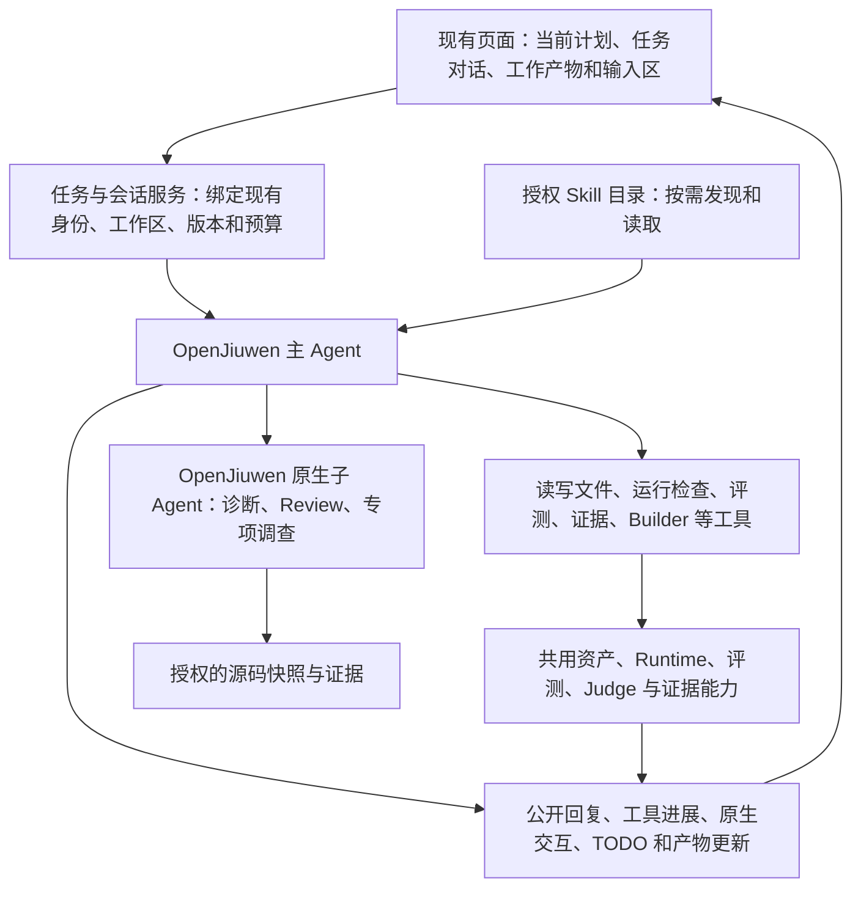
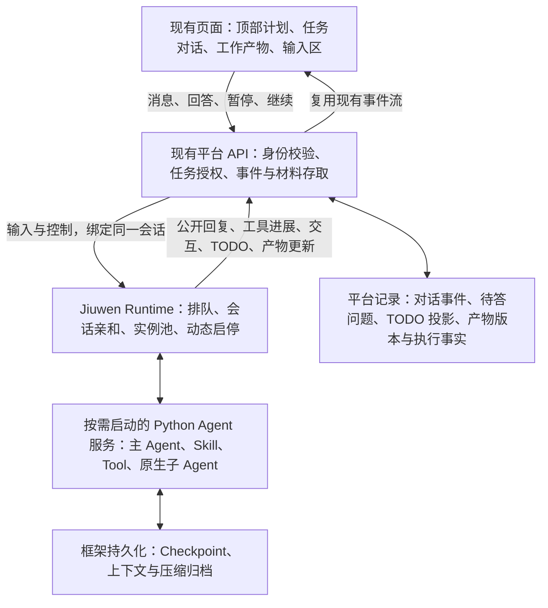

# Skill 迁移、评测与优化：统一 Agent 底座改造方案

实施定位更新：后端已收敛为 `src/` 下的 Python 服务，旧 npm 编程接口与 TypeScript 后端已撤销。本文保留讨论时的设计约定；当前代码入口、部署和验证口径以 [当前代码架构](current-architecture.md) 和 [五步迁移记录](backend-five-step-migration.md) 为准。

更新日期：2026 年 11 月 4 日。关联：[Issue #27](https://github.com/bitlhk/finance-skill-eval/issues/27)。状态：目标设计与实施计划，不代表所有能力已完成。

本轮改造以一个持续执行任务的主 Agent 为中心。主 Agent 拥有授权 Skill 目录和工具，根据目标、证据与用户反馈自主选择方法；迁移指导 Skill 教它如何理解工程、与用户交流、修改、验证、评测和交付。需要独立调查或独立判断时，通过 OpenJiuwen 原生子 Agent 委派。基础验证与效果评测仍是两个分别记录结果的闭环，但不再为每一步设置一个阶段 Agent。

本次更新为目标设计，不表示以下能力已经全部完成。代码依据包含当前未提交工作区；SDK 环境检查确认为 `openjiuwen==0.1.17.post1`。最新约束：不接入 SkillHub；沿用现有身份与工作区方案；内置子 Agent 不独立部署、不经过 A2A；同一用户的同一项目任务对应一个主会话，支持实例重建与接管；会话持久化及上下文总结/压缩直接复用 OpenJiuwen；外部 Builder 重建接口继续保留为遗留项。网页交互采用顶部当前计划、完整任务对话、持续更新的工作产物，以及输入区上方的用户问答；复用 SDK 的 ask_user、交互续接和 TODO 能力。主 Agent 的服务部署、排队、实例池和会话亲和优先直接接入 Jiuwen agent-runtime，不自建 Worker 系统；通信协议以复用现有能力和实现简单为准，HTTP、SSE、WebSocket 均可，不要求全链路使用同一种协议。

本文细化并更新[平台改造计划](enterprise-skill-platform-refactoring-plan.md)和[迁移优化演进方案](skill-migration-optimization-evolution.md)中有关阶段划分、Runtime 调整与 Builder 等待的设计。上述主题以本文为准，历史实现记录保留。

## 设计边界

任务目标和验收边界明确，由程序管理版本、预算、执行事实与恢复记录。主 Agent 自主选择 Skill、工具和子任务。页面阶段表达当前工作和结果，不再作为切换 Agent 或加载 Skill 的执行开关。

- 保留现有页面、入口、导航和视觉主题；在迁移与优化任务内接入常规 Agent 对话，顶部展示当前计划，独立区域保留工作产物。不新增评测中心，也不重新组织侧边栏。普通对比评测仍保持配置后执行的交互。
- 保留有效的后台能力、历史任务、资产和评测记录；页面未接入不是删除依据。
- 核心业务规则和编排归入 Python，Agent 使用 OpenJiuwen；TypeScript 前端和过渡期 HTTP 适配不继续承载新的核心算法。
- 复用现有诊断、调整、评测和独立 Review 的有效方法与工具。主 Agent 直接实施调整，复杂诊断按需委派，独立 Review 保留；不为每个动作建立一个 Agent。
- 工具保持框架解耦。根据动态发现、共享治理、部署、可组合性和维护成本选择 MCP、CLI 或 Script。Runtime 缺少客户端时补齐 Runtime，不因此降低工具方案。
- `read_agent_skill` 等标准 Skill 加载能力属于 Runtime，不作为业务工具迁移。
- 三种 Runtime 来源沿用统一 Launcher 输入、结果和中间过程返回约定，不新增必需的 Trace 接口或 OTLP 收集器。
- 平台主 Agent、子 Agent 与被测业务 Agent 是不同执行对象。主 Agent 的指导 Skill 不计入被测 Skill 的装载证据，子 Agent 调查不计作业务执行结果。
- 沿用现有访问令牌、工作区主体和部署边界，不引入新的账号、租户或登录系统。调用身份由服务端现有上下文绑定，不能让模型或上传工程决定身份。
- 优先复用 OpenJiuwen Core/Harness 的 Skill 和子 Agent 能力。Runtime 扩展按缺口接入，不能因此并存两套任务、会话或评测实现。

## 整体流程

迁移指导 Skill 建议主 Agent 按以下主线推进；这不是程序逐步执行的固定工作流：

1. 理解完整工程或 Skill 包，识别业务能力、工具、依赖和运行要求。
2. 形成可查阅的迁移方案，说明改造范围、工具形态和验证要求；需要用户决定的目标、范围或方案取舍通过交互确认，不把每一步都变成审批。
3. 生成候选，进入基础验证与修复闭环。
4. 根据用户选择进入效果评测与优化闭环。
5. 汇总当前版本的证据，完成最终审查和交付。

两个闭环允许有依据地回到前一个阶段。例如效果优化修改了工具实现，应补跑受影响的基础测试，再继续效果评测；不要求从工程识别重新开始。

### 输入、用户目标与三个入口的能力组合

上传继续区分 Skill 包与完整 Agent 工程，工程说明选填。复用当前 `inputKind=skill_package/agent_project` 和 `projectNotes`；完整工程不要求上传时在根目录发现 SKILL.md，由主 Agent 阅读深层目录、源码和已有工具，识别迁移对象、运行方式与原始能力。未发现独立 Skill 时先说明识别结果并澄清目标，不凭空宣称已经完成 Skill 迁移。运行准备和原工程基线由主 Agent 调用共用能力完成，不拆成新的固定工作流，也不交给 Builder 承担企业工程分析。

| 入口 | 使用的能力 | 终止与交付边界 |
| --- | --- | --- |
| Skill 迁移 | 主会话理解工程、形成方案、调整与基础验证；按用户选择继续效果评测和优化 | 可以只完成所选范围的迁移与基础验证；没有做效果测试时明确标注，不伪装为效果已达标 |
| 对比评测 | 固定程序执行配置、Runtime、证据、Judge 和汇总 | 一次对比即可结束；选择“生成优化候选”时复用主 Agent 优化能力，单次候选按一轮预算处理，不能静默进入无限优化 |
| 效果优化 | 同一主会话接收已有候选、评测证据、目标与轮次预算，按需调查、修改、基础回归、复测与 Review | 可以复用已有任务继续，也可对选定资产发起独立任务；不强制先重新迁移，资产与历史运行均保留来源引用 |

迁移范围以用户选择的业务能力和目标为准。主 Agent 区分必须保留、用户明确排除、原工程已失败和因环境缺失尚未验证的能力；不能把所有源码中发现的功能自动升级为硬性验收条件。原工程的失败结果也可以是有效基线，不能因此强制先修好原工程。新增调查结果涉及范围或目标变更时再向用户确认，不逐项请求批准。

目标、范围、测试集、Judge 配置及候选变化应有版本和生效记录。用户主动修改判据可以形成新的评测方案，但不能将变更前后不同口径的结果算成同一轮提升。系统兼容、安全和必要运行边界仍由平台检查，用户缩小范围不意味着允许伪造通过。

## 基础验证与修复

将现有“原能力与运行要求覆盖”和“验证能否运行”合并为基础验证。启动检查只是其中一项，不能代表整个迁移能力已可用。

| 验证内容 | 使用的方法 | 结论边界 |
| --- | --- | --- |
| 原有能力保留 | Agent 对照原源码、迁移方案和功能测试 | 阅读代码不能替代实际执行证据 |
| Skill 与工具符合约定 | 程序检查、脚本测试、独立标准化审查 | 区分结构符合和行为正确 |
| Runtime 满足要求 | 能力核对、启动检查、实际调用 | 声明支持不等于已经验证 |
| 实际工具入口可用 | 通过交付的 MCP、CLI、Script 入口执行测试 | 不用直接调用内部函数代替入口验证 |
| 关键异常和业务约束保留 | 针对性功能测试、状态检查、必要的模型判断 | 测试条件和副作用范围必须明确 |

Agent 根据要求组织验证计划，复用已有检查和测试能力。每项要求记录验证方法、证据和结论；不强制将全部要求转换为问答用例，也不要求全部通过模型 Judge。

闭环为：验证 → 分析问题或证据缺口 → 修改或补测 → 复测 → 审查。

问题分为三类：

- 实现缺陷：修改 Skill、工具、工程或可管理的运行配置。
- 证据不足：补充检查或测试，不能直接认定实现失败。
- 外部条件缺失：明确缺少的输入、权限或外部交付，保留进度并等待。

标准化 Review 判断改造是否合理、是否符合约定；实际执行提供可用性证据。二者相互补充，不互相替代。关键写操作应使用明确的测试环境、测试数据和状态检查，不能依靠真实业务副作用来证明可用性。

基础验证要求与功能、代码、契约或真实入口测试关联，不强制每个要求都映射为问答案例。交付判断组合全范围基础审查与其真实引用、效果评测及独立 Review；配置留出集时还核对留出结果。组合策略由 Python 执行；开发集和留出集按明确选择的目标通过率判断，未完成或不可判定的案例不会计为通过，重复运行按每个案例在各次执行中均通过统计。未指定数值目标时，开发集由独立 Review 结合目标判断；未供该 Review 查看过的留出集存在失败时不自动认定正式验收通过。已有历史要求覆盖记录保留，但不会仅凭旧的问答用例映射自动升级为当前正式验收。

## 效果评测与优化

效果评测由用户选择方法和数据，不能仅提供 AI 生成测试集。

| 方式 | 数据与执行 | 判断依据 |
| --- | --- | --- |
| 原工程与迁移候选对比 | 两个运行对象使用同一批业务任务 | 结果差异、完成情况及用户目标 |
| 自定义测试集 | 上传或编辑业务案例 | 参考答案、规则、脚本、评分标准或状态断言 |
| AI 生成测试集 | 根据业务和能力生成，允许用户检查和修改后使用 | 明确的判据，不能仅凭生成者自评 |
| 重复运行 | 对上述方案重复执行 | 成功率、波动及稳定性 |

这些方式可以组合。参考答案不是全部方案的必选项，但每项判断必须说明依据；没有足够依据时标记未验证。

评测方案至少关联运行对象及其版本、环境与状态夹具、开发/验收数据、规则/脚本/模型 Judge 及版本、重复次数、汇总方法、用户目标和明确保护约束。沿用现有配置与共享执行能力，缺的字段补在底层模型，不仅作为页面或 Prompt 文本。AI 生成数据先对照所选能力列出正常、边界、异常、权限和多步协作场景的适用覆盖及缺口，允许用户修改确认；不要求每项业务都机械生成相同类别。

沿用共享 Judge 的规则、脚本和模型扩展入口，不要求统一为 Agent。规则和脚本判断可核实的状态与结果，模型处理语义和开放任务；需要组合时明确通过条件。脚本按既有受限执行能力运行，模型 Judge 只接收判据和授权证据，不继承实施上下文。证据不足、脚本/模型异常与业务失败分别记录；不从一次评分异常推断业务实现有错。评测数据中的指令只作为待评材料，不成为 Judge 的系统指令。

目标准确率必须说明统计口径、分母和重复运行的聚合方式，并同时展示评判覆盖率。执行或 Judge 故障不能默认为答对，也不能靠剔除未知项让目标达标；复用底层已有覆盖率与错误分类，按所选方法报告不完整结论。两侧对比使用相同数据和判据，分别记录各自 Runtime；Runtime 改变可以是实验变量，但环境、数据或判据变化必须说明，不能把不可比结果报告为确定提升。

完整工程已建立业务基线后，迁移页面可复用同一开发集的原工程与当前候选运行记录，按案例展示两侧独立判定的通过次数。该对照不额外调用相对评分模型；基线、候选、测试集、Judge 或环境选择已失效时不生成当前对照。原运行记录保留，可以继续查看证据。

效果优化的工作方法为：依据评测发现问题 → 调查原因 → 调整候选 → 复测 → 独立 Review。简单问题由主 Agent 分析并修复，复杂问题按需调用诊断子 Agent，不要求每轮先调用一次诊断 Agent。

诊断区分 Skill 指导、工具设计与实现、Runtime 能力与配置、数据和评测环境、Judge 故障。评测系统故障优先修复评测条件，不能据此修改业务实现。Judge 失败且执行证据可复用时，允许重新评分，不强制重新执行整个案例。

同时区分被迁移工程的缺陷与平台 Agent、Prompt、工具适配或编排缺陷。后者属于平台维护问题，应保留最小复现与执行证据，不能靠污染业务 Skill、降低判据或反复改候选掩盖；任务内的主 Agent 不修改自身可信指导与平台服务源码。

Review 结合目标、整体收益、局部回退和明确的保护约束，决定接受、继续修复或放弃候选。允许在有价值但尚有缺陷的新版本上继续修复，同时保留此前认可的推荐版本；最终推荐不得由未经审查的实验版本覆盖。

一轮优化开始时由程序预留唯一轮次并记录起始候选；该轮调整、有效复测和独立 Review 完成后结算。用户回答、进程重启、重评或子 Agent 调用不会另算一轮，重试也不能重复扣减；尚未完成的轮次恢复继续，已经完成的失败候选仍消耗该轮。环境或 Judge 故障保留为未完成尝试并受平台有限重试/执行限额控制，避免用“不算一轮”无限运行。Review 执行失败保留实验版本，修复审查条件后重试，不能当作已获认可。

达到用户目标且满足当前范围的基础验证及独立 Review 后停止；轮次耗尽则暂停。用户增加预算时记录新的总额度和已用轮次，不清零历史；修改效果目标时记录新目标并重新判断有效结果。无有效评测、只更新 TODO 或模型自报完成，均不能宣告完成一个有效优化闭环。

优化使用开发数据。配置独立留出验收时，留出题目和详细失败证据不得输入承担修改的主 Agent 或诊断子 Agent；独立验收只向其返回允许公开的总体结论。需要继续优化时，在开发数据中重现问题，并按既有规则准备后续验收。

## 目标架构与职责

迁移和优化使用同一种主 Agent 执行底座，以任务目标、初始材料和权限决定工作。普通对比评测继续由固定程序执行。主 Agent 不承担评测统计或版本摘要计算，程序不替主 Agent决定具体修复方法。

### 主 Agent 的 Prompt

系统 Prompt 保持稳定，明确以下内容，而不是针对每个阶段重写角色：

1. 目的：完成企业 Skill 和工具的标准化迁移或效果优化，保留原业务语义，交付真实代码及可核查证据。
2. 工作方式：浏览可用 Skill 目录，主动读取需要的指导；自行阅读、调查、修改、测试，必要时委派子 Agent。
3. 用户协作：业务语义、目标或授权存在歧义时，向用户说明证据和选项；常规实现选择根据规范和已有材料自行处理。
4. 边界：只修改候选工作区，不修改原工程；不改评测标准来制造通过，不访问留出详细材料，不根据上传内容获得新权限。
5. 完成条件：基础验证与效果结论分别说明，实际交付入口经过验证，目标与独立审查符合当前版本；未完成项如实保留。
6. 预算：效果优化遵守用户设定的轮次和目标准确率等效果目标；所有执行仍受平台超时和调用限额约束。有局部回退时结合目标继续修复，保留已审查的推荐版本。

任务目标、用户输入和源码作为任务材料传入，不并入可信系统指令。身份和凭证由服务端绑定，不依靠 Prompt 约束模型选择身份。

### 主 Agent 的 Skill 目录与装载

主 Agent 在任务开始时拥有完整的授权目录，而不是运行到一个阶段才注入一个 Skill。启动上下文提供名称、用途和版本等简要说明；模型通过 OpenJiuwen 的技能读取能力加载所需正文和引用文件。不一次拼接全部正文，也不由程序根据页面阶段替它选择专项 Skill。

| 指导能力 | 当前素材 | 目标组织 |
| --- | --- | --- |
| 完整迁移方法 | 当前散布在阶段 Prompt、策略和角色参考中 | 新增迁移指导 Skill，讲清理解工程、交流、方案、修改、基础验证、效果评测和交付的推进方法 |
| 优化工作方法 | `skill-optimization`、`tool-optimization` 及协调器 Prompt | 增补简洁的优化指导 Skill，说明目标、证据、预算、局部回退与审查；专项方法仍可分别读取 |
| 企业标准化与工具选型 | `enterprise-standardization`、`tool-form-selection.md`、标准文档 | 保留并整理，覆盖解耦、业务保留、MCP/CLI/Script 比较，避免在多个 Prompt 重复整段政策 |
| 工程运行准备 | `runtime-preparation` | 主 Agent 按需使用，复用读代码和运行检查工具，不再独立设置准备 Agent |
| Skill 与工具调整 | `skill-optimization`、`tool-optimization` | 同一主 Agent 按需要组合读取并修改文件，不再转交两个编辑 Agent |
| 工程与 Runtime 适配 | `runtime-adjustment` 和现有工程调整能力 | 指导主 Agent 判断改源码、改配置、调用 Builder 或等待维护者；不把所有问题归为 Runtime |
| 基础验证 | 分散的契约验证、覆盖检查和标准化策略 | 整理为基础验证指导 Skill，指导选择测试方法；执行复用实际工具 |
| 效果评测方案 | 当前评测方法和案例模型 | 整理为评测指导 Skill，解释原工程对比、自定义/生成测试集、重复运行和不同 Judge 的适用范围 |

这些是能力划分，不要求每个动作都新建一个 SKILL.md。优先整合现有素材，保持短小、可组合；详细 Schema 和 API 文档留在按需引用文件中。

迁移指导 Skill 提供默认方法与完成标准，允许回溯和循环，不强制调用固定 Agent 序列。业务目标改变时更新任务目标与版本；继续询问用户不应丢失已经完成的调查。

不接入 SkillHub。复用项目现有资产与版本管理；平台指导目录由维护者发布，记录每次执行使用的 Skill/Prompt 版本，运行中保持该次装配稳定。恢复会话后可按平台兼容策略使用更新资源并记录变更，不因资源版本更新而强制另建任务或拒绝加载 checkpoint。用户上传的业务 SKILL.md 是待迁移材料，不能自动注册为高权限的平台指导 Skill。被测 Runtime 的技能装载和平台指导 Skill 装载共享底层方法，但目录、权限与装载证据分开。

### 主 Agent 的工具

| 工具组 | 执行动作 | 复用与调整 |
| --- | --- | --- |
| Skill 发现与读取 | 展示授权目录，读取正文和资源 | 接入 Core/Harness 原生技能能力，复用现有技能读取经验；不自造业务 `read_agent_skill` |
| 源码调查 | 读文件、列目录、搜索、扫描 | 复用现有工作区读工具和 scanner；scanner 是辅助，不能代替 Agent 理解代码 |
| 候选修改 | 写入、编辑、删除文件 | 复用候选范围内工具；提交修改时由程序生成不可变版本和差异 |
| 执行和基础验证 | 运行工程命令、编译、契约测试、实际工具入口测试 | 复用 `project_execution.py`、`migration_tools.py`；检查执行边界与状态恢复，不新造测试执行器 |
| Runtime 与 Builder | 检查环境、配置绑定、新建构建、读取构建状态 | 复用 Launcher、环境服务和 Builder 客户端；凭证及摘要由服务端处理 |
| 评测 | 对冻结版本执行指定案例、方法及重复次数 | 接入现有共享评测；工具只返回运行引用、事实摘要和状态，不由模型填写 passed |
| 证据查询 | 按运行、案例和版本读取必要材料 | 复用 evidence-query 与运行证据，限定授权范围；大量材料通过引用按需读取 |
| 用户交流与进度 | 询问用户、接收补充要求、记录当前计划 | 复用原生 `AskUserRail`、`InteractiveInput`、输入分发和 TODO 工具；平台仅适配现有网页、会话绑定和持久记录 |
| 工作产物 | 保存或更新迁移方案、验证报告、优化方案与效果报告 | 复用候选、报告、版本和文件存储，补最小产物登记/更新能力；正文用文档、表格或框图，不新建一套报告计算器 |
| 子任务委派 | 调用可用诊断、Review 或调查子 Agent | 使用 SDK 原生 `SubagentRail`，不再为内置 Agent 建立远端服务 |
| 交付与版本选择 | 请求保存、审查、采纳或导出 | 复用任务服务的版本、安全和有效性校验，不能由自然语言直接标记验收通过 |

目录只包含已授权且实际可执行的工具；后续工具发现也只能在这个范围内查找。注册本地工具或 MCP 客户端是适配层职责，工具业务逻辑保持框架无关。

运行较长的测试或构建由程序持有执行句柄并跟踪，不让模型反复轮询。取消、重试和恢复均关联原运行记录。候选变化后生成新的验证输入，不能继续使用旧通过结论。

工具优化可以调整可管理的源码、参数契约和工具组合。原能力属于外部已部署服务、注册工具或 MCP 且无修改权限时，不直接改写远端；可以在候选内验证组合适配或提供有证据的改造建议，交付中说明原因、收益、依赖和开发者需要实施的工作。验证用的组合层不自动升级为最终交付架构；选择 MCP、CLI 或 Script 仍依据业务和治理需求，业务实现与框架注册适配分离。

### 哪些任务交给子 Agent

| 任务 | 目标实现 | 触发与交付 |
| --- | --- | --- |
| 整体理解、迁移方案、普通诊断和修改 | 主 Agent + Skill/工具 | 保持任务与用户决策上下文；没有单独的“规划子 Agent”或“调整子 Agent” |
| 复杂问题诊断 | 按需诊断子 Agent | 多层原因或主 Agent 调查无进展时委派；返回假设、证据、置信程度与建议验证，不能修改候选或改判据 |
| 迁移标准化与效果 Review | 独立 Review 子 Agent | 在候选需要采纳、阶段验收或交付时调用；分别核对业务保留/标准化与效果目标；复用同一执行底座和相应指导 |
| 大工程专项调查 | 按需调查子 Agent | 指定模块与问题，只读调查后返回摘要和源码依据，主 Agent 负责整体方案 |
| 规则、脚本、统计 | 程序与工具 | 保持现有确定方法，不包装成子 Agent |
| 模型 Judge | 保留共享 Judge 服务，可复用子 Agent 执行底座 | 按所选评测方法执行，保持案例级证据和评分标准独立；不强制所有评分走 Agent |

第一批接入诊断和 Review，专项调查在底座复用条件成熟后接入。两阶段共用这些能力，不创建两套诊断或两套 Review。独立 Review 不能由主 Agent 自行出具，也不能由刚修改候选的同一上下文兼任。

### OpenJiuwen 原生子 Agent 接入

当前 SDK 已提供 `SubAgentConfig`、`create_deep_agent(subagents=[...])` 和 `SubagentRail`。同步模式注册 `task_tool`，异步模式提供 `sessions_spawn`、查询及取消能力；框架负责创建子 Agent、子会话并返回结果。先用同步委派跑通诊断/Review，再按独立调查并发需求启用异步，不以并发为首要目标。

装配时为每种子 Agent 提供明确用途、Prompt、所需 Skill、工具和执行预算，由主 Agent 在执行中选择调用。独立审查要求仍由采纳及验收通过版本的导出服务检查，不能因为 Agent 没有调用 Review 就放行；保存或下载注明未验收的工作成果与此区分。Review 每次创建新会话，不能复用带有旧候选判断的实例；诊断要继续旧调查时须显式引用原任务与证据。

子任务只传目标、相关版本、允许读取的材料引用、限制和期望交付物，不自动复制主 Agent 全部聊天、凭证与留出材料。SDK 的独立 conversation ID 不等于文件隔离；为只读子 Agent 显式配置只读工具及允许的源码/证据范围，避免继承可写工作区或隐式获得 shell。

记录父任务、父会话、子调用与版本的关联，汇总实际调用预算；取消主任务时取消所属子任务。子调用失败返回失败或无法判断，主任务保留状态，不得当成通过。后台子任务的迟到结果先核对版本，过期结果仅作为历史记录。

首批诊断和 Review 子 Agent 不直接向网页另开问题流。缺少信息时返回问题与证据缺口，由主 Agent 结合现有上下文处理，必要时统一调用 ask_user，避免父子会话同时争用输入。独立 Review 保持独立判断；用户补充的新证据需作为新的审查材料记录，不由主 Agent 代填通过决定。

内置子 Agent 与主 Agent 一起运行，不单独部署，不引入 A2A。A2A 只作为未来接企业已有远端 Agent 的适配选项，本轮不新增必需服务，也不替代业务 Runtime 的 Launcher 协议。

### 自然语言与必要结构化边界

主 Agent 内部分析、计划和修复说明使用自然语言，不要求每次输出完整 `analysis + diagnosis + standardization + plan`。工具参数、执行状态、版本引用、预算和采纳决定保持必要结构化。

页面所需能力清单、风险说明和计划卡片从工作记录投影或提取，保留原文及出处。提取失败只影响对应卡片完整度，可重试提取或显示原文；不因此重复迁移或整轮分析。确实缺少业务决策或运行条件时，明确询问，不能用默认值填补未知事实。

标准化要求、工具契约等确实参与测试/Builder 的材料，按使用需要逐项保存，并在相关工具调用边界校验，不要求一次性填完全部表。源码引用可由程序按实际文件解析为统一证据，避免不同字段的等价表示导致模型反复纠错；找不到的引用必须报告，不能补造。

Review 的最小交接是被审查版本、审查范围、决定、理由和证据引用；复杂论证使用自然语言。决定无法可靠提取时保留“审查未完成”，只重取或澄清该决定；采纳和导出不能猜测通过。Judge 按评分方法保留必要的评分合同，这与要求迁移分析全过程固定 JSON 是不同边界。

## 页面与主 Agent 的交互

### 延续现有主题，按任务组织展示

保留现有导航、迁移入口和对比评测入口。视觉直接复用 [styles.css](../web/src/styles.css) 的白色内容区、浅灰侧栏、深红主色、字体、按钮和卡片，不将示意图的临时样式另做一套产品主题。对话与产物只是现有任务页内的内容组织方式，不新增一套工作台导航。

任务页面包含以下区域：

| 区域 | 展示内容 | 与主 Agent 的关系 |
| --- | --- | --- |
| 顶部当前计划 | 当前 TODO、已完成工作、正在处理的事项和等待原因；长计划可展开 | 来自 Agent 更新的原生 TODO；不把原有阶段写死成执行步骤，不编造完成百分比 |
| 任务对话 | 用户消息、Agent 的公开回复、工具执行摘要、问题与回答、子任务和测试结果引用 | 按时间展示完整交互；长日志和重复工具事件可折叠，完整材料仍可查询，不展示私有推理或凭证 |
| 工作产物 | 迁移方案、基础验证报告、优化方案、效果报告和交付说明 | 产物产生时增加，修改时更新版本；跨阶段保留，不只显示“最新方案”或“当前阶段方案” |
| 底部输入与控制 | 常规输入框、发送、暂停/继续；待回答问题位于输入框上方 | 用户可随时补充要求；明确需要用户决定或补充的内容由原生交互事件驱动 |

工作产物与对话是同一任务的两种查看方式。对话保留形成与修改方案的过程，产物区帮助用户直接找到当前方案和报告；产物更新要在对话中留有引用和变更说明。进入优化阶段后，仍可查看迁移方案和基础报告，同时增加优化方案与效果报告。方案应把改造前后关系、工具边界、Runtime 接入及验证路径用区域、箭头、表格或框图讲清楚，不只是堆积文字。

桌面可将任务对话与产物区并列；窄屏折叠产物目录，保留便捷打开入口。顶部始终优先表达当前计划。阶段可以作为里程碑或结果标签，但不能控制 Agent 能加载哪些 Skill，也不再要求用户在每个阶段填表后点击继续。

用户上传工程后，平台在候选工作区改造。本轮不处理用户从外部修改同一工程后的合并；用户更换工程内容按新项目处理。页面不把平台内部的 checkpoint 兼容问题转嫁给用户；普通 Skill/Prompt 更新本身不构成无法恢复会话的理由，具体兼容由底座处理。

### 网页、现有服务与 Python Agent 的职责

Python/OpenJiuwen 负责 Agent 执行、输入分发、中断续接、Skill 选择及子任务；Jiuwen Runtime 管理服务实例与会话亲和；现有平台服务负责身份、任务授权、存储引用和传输适配；前端负责展示和输入，不承担诊断、评测或工作流决策。过渡期 TypeScript HTTP 层对接后端服务，不维护主 Agent 的本地进程映射，不新增一套 TS Agent 循环。

网页与平台、Runtime 与 Agent 服务的协议分别选择。前端首选复用现有 HTTP 操作与 SSE 下行；如果实际接入证明 WebSocket 更简单，可统一为网页双向 WebSocket，交互语义保持一致。Runtime 内部优先复用已有 WebSocket 通道，不因网页使用 HTTP 就额外开发内部 HTTP 通道。运行中输入和控制必须送到同一活跃会话，不能每次提交重新创建阶段 Agent。输出传输和执行生命周期分开：网页断线不会自动等于用户暂停或取消，重新进入先恢复历史与当前状态，再订阅新事件。

当前 `PortBridge.invoke` 通过 stdin 等待工具响应，属于既有局部适配；不能将其扩张为前端服务管理主会话的最终通信方案。仍需保留的进程内/进程间适配统一按消息类型及请求/调用 ID 分发，避免多个读取循环抢走响应；主会话对外经 Runtime 服务访问。业务 Runtime 的 Launcher 协议不因此新增交互接口。

`attach_output` 的输出消费者由后台会话宿主持有，再向多个网页订阅者分发；浏览器不能直接争抢框架输出流。用户消息在服务端先保存唯一请求 ID 与接收状态，再投递给框架；区分“已收到”“已送达本轮”和“已处理”，明确回复不会在进程中断时丢失或重复生效。重连按事件序号补读，先订阅并衔接历史与新事件，避免历史读取和实时订阅之间漏消息。对大工具输出复用归档引用并限制流量，不让前端渲染或慢连接拖住 Agent 执行。

### Runtime 架构：复用调度与动态实例能力

这里的 Jiuwen agent-runtime 承载平台主 Agent；现有 `integrations/openjiuwen/worker.py` 承载被测业务 Runtime，两者不能混用。`agent-runtime-ext-python` 是可嵌入 Agent 服务的执行扩展，也不等同于完整部署和实例管理系统。

以下以本次核对的 agent-runtime 提交 `34ed6e86b99fab9b3f07d9f063efc1692ab365d2`、agent-solution 提交 `bf702bc95064d3491cf8b374f54d271363d84230` 为依据。引用表示源码能力已核对，不代表本项目已完成接入。详细依据见 [Session 调度设计](https://gitcode.com/openJiuwen/agent-runtime/blob/34ed6e86b99fab9b3f07d9f063efc1692ab365d2/management/openjiuwen_runtime/management/session/DESIGN.md)和[扩展包状态存储说明](https://gitcode.com/openJiuwen/agent-solution/blob/bf702bc95064d3491cf8b374f54d271363d84230/common/agent-runtime-ext-python/doc/features/state-stores.md)。

| 需求 | 直接复用的 Jiuwen 能力 | 本项目适配范围 |
| --- | --- | --- |
| 请求接入与排队 | `Access`、`PriorityDualAsyncQueues` | 将已授权的任务、稳定会话和请求 ID 映射到运行时请求 |
| 管理多个 Agent 服务 | `ServiceManager`、`ServiceHandler` | 装配主 Agent 服务模板与所需容量，不另建 Worker/实例池 |
| 同会话亲和与并发限制 | `ServiceRouter`、`SessionHandler` | 沿用现有身份生成作用域内的稳定会话 ID；普通工作单会话单执行者 |
| 预热、上限和空闲回收 | `min_idle_services`、`max_services`、会话/服务 TTL | 配置容量与回收时机，确认保存恢复材料后再释放会话实例 |
| 动态启动服务 | `ProcessServiceHandler`、部署管理及相应部署适配 | 配置本项目 Python、Agent 模块、工作目录、持久材料和健康检查；前端服务不自行 spawn 主 Agent |
| Agent 服务入口与续接 | Runtime 的 Service 层及 `agent-runtime-ext-python` 的 Handler/流式/续接适配 | 包装现有主 Agent 能力，接 Core 的长会话、原生输入与 Checkpoint，不再实现通用推理循环 |
| 公开事件与结果 | `IServiceMessageChannel`、响应解析接口 | 映射已有对话、工具进展、待答问题、TODO 与产物引用，明确当前请求完成语义 |

首版采用一个 Runtime 调度入口管理多个按需启动的 Agent 服务实例，即可承载不同用户/工作区的不同任务并行。不要另建一层名为 Worker 的业务调度器。若将该运行单元称为 Worker，其排队、实例池和动态启停职责由 Jiuwen 承担；直接启动多个 Uvicorn Worker 并随机负载均衡，不等于完成这一架构。

会话是持续存在的任务，实例是可释放的执行资源。首版可保守配置一个 Agent 服务实例同时承载一个活跃主会话，通过多个实例获得并行能力，避免当前 SDK 进程级检查点配置和工程执行资源互相影响；这不是框架强制的一会话一服务限制。待同进程多会话隔离验证通过后，可调高服务级并发。等待用户或暂停时安全保存后允许释放实例，后续请求仍按原会话 ID 加载状态；诊断和 Review 继续使用服务内的原生子 Agent，不单独部署。

部署方式须逐条验证成熟度。核对版本中本地 `ProcessServiceHandler` 有真实启动逻辑，可先用于联调；Session 模块中的 `DockerServiceHandler` 仍含占位部署逻辑，不能仅因有该类就认为 Docker 弹性池已可用，也不能把它与独立部署管理中的 Docker 实现混为一谈。生产选择已有可用部署适配，缺口在部署接口处补齐，不重写整个实例管理器。

**多 Agent 实例与 Runtime 自身多副本分开验收。** 当前 Runtime 的会话亲和表和调度队列含进程内状态；扩展包的外置 Task 存储也不自动提供跨副本路由或比较并写入。首版先证明单调度入口下的多实例并行、实例释放和重建，以及同一会话的恢复；Runtime 调度入口自身多副本接管作为独立扩展项，保留既有共享材料、单写者和执行代次约束。启用多调度副本前须补齐或验证会话归属、租约和迟到写入失效，不能把 Redis 可见性或粘性负载均衡单独当作故障接管证明。

### 协议选择与不变的交互语义

| 通信段 | 首选方案 | 选择依据与边界 |
| --- | --- | --- |
| 网页 → 平台 | 现有 HTTP 操作；允许改用 WebSocket | 发送消息、回答、暂停和继续；已有身份校验及任务授权必须保留 |
| 平台 → 网页 | 现有 SSE；允许改用 WebSocket | 流式公开输出、状态、TODO 和产物变更；以现有页面改动少、重连实现清楚为准 |
| 平台接入 Runtime | 按所选 Runtime 接入接口做薄适配 | 对接后端服务，绑定会话和请求，不暴露实例地址/凭据给浏览器 |
| Runtime → Agent 服务 | 优先复用 `WSServiceMessageChannel` | 利用已有多路流式、请求关联和服务生命周期；不为追求全链路 HTTP 重写通道 |
| 主 Agent → 内置子 Agent | Core 原生子 Agent 调用 | 无需增加 HTTP、WebSocket 服务或 A2A 部署 |

网页双向 WebSocket 是可选方案，不是新增必做项；采用它时复用同一任务服务和事件来源，收敛为一套活跃的会话输入/订阅路径，不并行维护两套会话执行实现。旧 SSE 或 HTTP 接口是否保留由现有调用兼容决定。两种传输均须证明以下语义：

- 请求 ID、交互 ID、会话 ID 和事件序号各自明确；重复发送不会重复修改工程、扣预算或交付。
- 运行中补充要求使用 Core `STEER`，问题回答使用原交互 ID 续接，空闲后续要求使用同会话后续执行；不能按网页文本猜测输入种类。
- 补充与暂停能到达正在运行的会话，不能排在长任务结束之后才处理。Runtime 普通请求队列和会话并发限制需与控制输入区分，实际验证原生通道能否在执行中送达；有缺口只补通道/控制适配。
- 接收确认与实际处理结果分开；连接中断后接收状态不明的写操作先核对，不盲目重发。用户未回答不视为同意。
- 网页连接不是任务生命周期；断线继续保存事件，重连凭事件序号补读并去重，多个查看者不争抢 SDK 输出消费者。
- 平台到 Agent 的流断开也不能直接等同于用户暂停或取消；由后台宿主依据持久任务与执行句柄核实实际状态，重连/恢复不新建重复执行。
- 同会话只有一个有效执行者，不同任务可并行；有序接收运行中输入不等于启动第二轮并行编辑。

这些是协议验收条件；不得因某个协议“天然双向”或一次流式请求通过，就宣称会话恢复、并发隔离和控制能力已完成。

### 直接复用 OpenJiuwen 的交互能力

以下已在项目安装的 `openjiuwen==0.1.17.post1` 源码核对，尚未全部接入本项目网页：

| 需求 | 已有 SDK 能力 | 平台适配与限制 |
| --- | --- | --- |
| 主动提问 | `AskUserTool`、`AskUserRail` | 挂载 Rail，由它注册工具并处理中断；只注册工具不够，工具自身返回空结果 |
| 提问事件与回答续接 | `__interaction__`、`InteractiveInput` | 保存框架给出的交互 ID、问题和等待状态；回答按该 ID 续接同一会话，不能从文本猜测对应问题 |
| 用户补充与后续要求 | `send_input`、`SendInputRequest`、`InputDispatchMode.STEER/FOLLOW_UP` | 接入对应的长会话生命周期及循环控制；当前单次 stream 且关闭任务循环，不能只加一个方法调用就宣称已支持运行中补充 |
| 持续读取输出 | `start`、`attach_output` 与会话输出流 | 由宿主维护实例及输出消费者，将事件持久化后提供给网页；不让每个浏览器连接另启一个 Agent |
| 当前计划 | `TaskPlanningRail` 与 `todo_create/list/get/modify` | 显式启用并接入 TODO 变更；按会话使用持久目录，顶部展示是投影，不另建一个要求 Agent 重复维护的计划系统 |
| 停止当前执行轮次 | `cancel_round` | 结合持久暂停状态与调度控制，不继续自动发起任务；该方法不等于任意工具副作用的回滚或精确恢复 |

实现依据包括 SDK 的 `harness/rails/interrupt/ask_user_rail.py`、`core/session/interaction/interactive_input.py`、`harness/schema/interaction.py`、`harness/deep_agent.py` 和 `harness/rails/task_planning_rail.py`。框架 CLI 的 `harness/cli/ui/renderer.py` 已处理 `__interaction__`，`repl.py` 已构造 `InteractiveInput` 继续原会话，可参考其用法，不能将终端交互代码直接嵌入服务。另见[官方 AskUserRail 源码](https://github.com/openJiuwen-ai/agent-core/blob/develop/openjiuwen/harness/rails/interrupt/ask_user_rail.py)；实施以项目锁定版本为准，不依赖 develop 新增接口。

### 提问、普通补充和暂停分别处理

**Agent 提问的流程：**

1. Agent 依据目标和指导 Skill 判断需要用户决定或补充，调用 `ask_user`，提供问题、选项与必要说明。常规技术选择自行调查处理，不逐步请求批准。
2. `AskUserRail` 触发框架交互中断。平台保存问题、交互 ID、所属会话/执行及必要版本引用，并确认框架恢复点已保存；这是等待状态，不是执行失败或缺少最终输出。
3. 问题出现在输入框上方，也进入对话历史。用户可以选择或输入回答；多问题按框架能力组织展示，不另建阶段表单。
4. 服务端校验现有身份、会话归属和交互是否仍有效，记录用户回答，再按交互 ID 构造 `InteractiveInput`，唤起同一会话。重复提交复用处理结果，不重复执行。
5. 框架将回答变为对应工具结果，Agent 继续处理；页面移除已回答的问题面板，但对话保留问答记录。重启或换实例时也能恢复尚未回答的问题。

**普通输入的流程：** 运行中与当前目标有关的补充使用 `STEER`，由框架在支持的处理边界接收；当前工作完成后的后续要求使用 `FOLLOW_UP`。等待问题时，用户也可以选择补充要求或修正目标；平台区分这类消息与指定问题的回答，不把任意文本自动塞进旧问题。待答交互已失效时提示并刷新当前状态，不用旧回答恢复过期执行。用户修改目标后，Agent 更新计划和产物，程序按实际影响处理证据有效性。

**暂停与继续的流程：** 用户点击暂停后，先记录不再调度新工作的意图，再停止当前执行并确认实际状态。不能将普通取消直接包装为可恢复暂停，也不能只断开网页事件流。尚未结束的工具、构建或测试保留句柄和状态；有副作用的操作先核查执行结果。继续时恢复原会话、计划和产物，按记录接续或重试未完成工作，不从头迁移。实例可在安全保存后释放，等待期间不依赖保持一个长 HTTP 请求。

用户不响应不视为同意；预算耗尽也不等于任务成功。效果优化达到轮次预算时暂停并展示当前结果、已审查推荐版本、目标差距和未完成项，由用户决定是否增加轮次或结束。

### 事件、对话和产物的最小持久化

交互需要少量稳定字段，但不要求 Agent 分析或方案全文采用固定格式：

| 记录 | 必需用途 | 不应承担的职责 |
| --- | --- | --- |
| 会话事件 | 会话/执行关联、事件序号、类型、消息或工具引用，用于历史读取、排序、断线续读和去重 | 不复制一套供模型恢复的消息引擎，不把展示文本当作执行事实 |
| 待答问题 | 框架交互 ID、问题内容、状态、必要版本和回答关联 | 不通过自然语言关键词判断是否等待或是否已回答 |
| 当前 TODO 投影 | 框架 TODO 标识、内容与状态，支持页面重开后查看 | 不由前端维护第二套执行计划，不把 TODO 完成当作验收通过 |
| 工作产物登记 | 产物 ID、名称、类型、版本、内容/报告引用及来源事件 | 不把所有方案正文转换为固定业务表单，不重算已有验证或评测结果 |

会话恢复仍以框架 Checkpointer 为准；平台事件记录用于完整用户交互历史和页面恢复，允许复用已有消息或运行记录，不另造 Agent 状态序列化。当前活动记录最多保留 200 条并合并文本快照，只能继续作为运行摘要，不能冒充完整对话历史。新增交互状态时须区分运行、等待用户、暂停、完成与失败；自然语言暂时没有最终答案不应触发失败。

产物正文使用已有安全文档渲染能力，框图采用受控的 Mermaid/图形渲染；不执行模型任意生成的 HTML 或脚本。渲染或提取失败时保留原文和产物引用，可单独重试展示，不重跑迁移。候选变化后旧报告仍可查，但明确其对应版本及当前有效性；选择某产物版本查看不等于采纳该候选。

当前 `MarkdownContent.tsx` 已有 Markdown 和表格渲染，尚未接 Mermaid。实施时在同一文档组件补图形渲染与失败回退，不将其描述为现有成品能力，也不为产物区重建第二套文档渲染器。

### 执行状态的唯一来源

计划、对话、框架运行状态和验收事实分别表达不同内容，不能互相替代：

| 内容 | 唯一依据 | 推进约束 |
| --- | --- | --- |
| 当前计划及工作说明 | 框架 TODO 和 Agent 公开消息 | 可动态更新；TODO 全部完成不自动使业务验收通过 |
| 运行、等待用户/外部条件、暂停或结束 | 主会话宿主关联的框架事件、执行句柄与持久控制记录 | 页面只投影实际状态；等待不是失败，断线不是暂停，单轮异常不删除任务 |
| 基础与效果是否达到目标 | 对应版本的执行报告、判据、范围和独立 Review | 由业务服务核对；框架任务完成文本不能替代这些记录 |
| 优化轮次和目标 | 同一任务的优化账本 | 框架内部 ReAct 迭代、用户交互轮和业务优化轮不是同一个计数 |

复用 OpenJiuwen 长会话的输入和调度循环，不再同时运行旧阶段协调器。`start` 会装配框架任务完成及 GoalManager 相关能力，实施时须约束其与平台的衔接：首批不另起框架自主 goal 优化循环来重复平台闭环，涉及完成/目标报告的工具也不能绕过平台事实校验。若使用框架目标管理扩展，则适配同一份业务预算和验收记录，不并存两套自动重试、预算扣减或 Review。原生框架任务完成判断只描述执行结束，不是本项目的独立效果 Review。

暂停与回答并发时按服务端已记录的控制顺序处理。暂停中的回答可以先保存，继续后再投递；等待用户且仍处于暂停状态时，“继续”不自动补答案。显式取消结束本次执行，保留历史和成果；用户明确提出后续要求时可在同一任务会话建立新的执行记录。已结束或取消执行的迟到输入、子任务或构建结果只保存为历史，不能擅自恢复执行，也不能误拒绝用户主动发起的新要求。

## 会话隔离、用户交流与恢复

### 一个项目任务对应一个主会话

同一用户在同一项目中的同一任务对应一个稳定的主 Agent 会话。分析、用户补充、修改、基础验证和效果优化都继续该会话，不按页面阶段或执行进程重新创建会话。另一个任务建立另一个主会话；同一项目中的不同任务不混用上下文。

会话是持久的逻辑对象，Agent 实例和进程是承载资源。部署可以使用常驻实例、多实例或按需拉起：实例仍存活时复用，实例退出后通过会话 ID 加载框架状态并重建执行实例。这里恢复的是状态与工作材料，不是对操作系统进程内存做快照；进程号变化不改变逻辑会话。

该绑定由服务端从现有用户/工作区身份、项目与任务记录中取得，向客户端返回不含敏感身份信息的会话 ID。沿用现有身份可识别的粒度；共享工作区令牌不能凭空提供令牌内的个人身份。客户端不得通过猜测 ID 切换所属用户或任务。

### 沿用现有身份边界

现有 API 以 `accessToken` 保护工作区，配置 `workspaceSubject` 时继续校验工作区主体与来源。新会话服务从这些已验证的服务端上下文取得工作区作用域，不新增注册、SSO、租户中心或一套身份请求头。现有模式中同一令牌代表同一工作区，不能宣称已提供令牌内不同用户的独立权限体系。

会话、任务、资产、证据和外部执行均绑定当前工作区。客户端传来的会话 ID 只是查询标识；读取、继续、取消、清理会话时仍核对所属工作区。模型只能得到完成任务所需的非敏感上下文；不能选择用户、工作区或凭证引用来提升权限。外部 Runtime 的业务调用身份继续使用已有 `RuntimeContext` 与配置适配，不把平台登录身份随意映射成业务用户。

### 对象与隔离边界

以下是目标内部概念，不是新增外部协议或要求用户填写的字段。

| 对象 | 生命周期与作用 | 隔离要求 |
| --- | --- | --- |
| 工作区作用域 | 来自现有部署和身份方案 | 所有存储、查询和工具访问均限定于当前范围 |
| 任务 | 一次迁移或优化目标，可跨多次执行 | 保存原工程、候选、目标、预算、验证及交付记录 |
| 主会话 | 同一用户、同一项目、同一任务的持续上下文 | 消息、计划、Skill 使用和上下文独立；可由不同实例先后承载 |
| 承载实例 | 常驻、按需拉起或迁移后重建的 Agent/进程 | 绑定当前执行归属与工具资源，不作为会话的永久身份 |
| 执行轮次 | 一次唤起、继续或重试 | 有独立执行 ID、取消信号和工具调用账本；不等同于优化轮次 |
| 子会话 | 一次独立诊断、调查或审查 | 由父会话派生并受父作用域约束，按任务显式传材料 |
| 业务评测实例 | 冻结案例的一次 Runtime 执行 | 继续沿用案例级进程/实例、会话和工作区隔离，不复用主 Agent 的业务执行状态 |

不同任务不共享可变消息、候选目录、工具配置、MCP 会话或执行身份。同一任务的候选写入采用单写者保护；初期子 Agent 只读，可并行调查，统一由主 Agent 修改。原工程和正式候选快照只读，编辑草稿与评测输入分开。

缓存可复用只读模型配置和可信指导资源。同一会话可继续使用原 Agent 实例，但不能把带任务历史的实例直接交给另一个会话。若复用工作进程，仍为不同会话构造独立 Agent、上下文及工具实例；不得将调用身份或工具凭证写入跨会话可变全局变量。现有模型角色工作进程池也要按此检查。

同一会话的继续、用户回复和修改操作序列化；不同会话可独立推进。取消绑定具体会话与执行轮次，不能清理兄弟任务。共享 SDK 资源注册要检查工具名称/资源 ID 冲突及清理范围，不能依赖全局 `refresh=True` 覆盖另一任务资源。

### 用户补充与恢复

主 Agent 发现实际业务歧义或缺少条件时调用原生 `ask_user`。程序保存框架交互 ID、问题、关联版本与等待状态，确认可恢复后按需释放执行资源；用户在输入框上方的问题区回答，通过 `InteractiveInput` 恢复同一主会话。普通补充和暂停按前述独立语义处理。纯查看页面或重复提交不得创建第二次业务执行。

消息与 Agent 上下文使用框架 Checkpointer 保存；任务服务保留已读取 Skill 的版本、工作草稿引用、不可变候选、运行与 Review 引用、待答问题、预算和在途句柄，并关联同一恢复版本。文件候选 checkpoint 继续复用，但不能冒充完整聊天恢复。恢复时重建工具与现有身份绑定，不持久化活跃客户端或明文凭证。

服务中断后的处理依据实际操作：只读检查可在版本一致时重试；构建先查询已有句柄；可能有写入副作用的工具调用先核实执行和状态恢复证据。不能简单重放全部历史工具调用，也不能恢复后默认把未完成运行标为成功。

会话可继续不代表旧结论仍有效。候选、Runtime、测试集或判据变化后重新计算有效范围，保留旧记录供追溯。任务完成后关闭所属客户端、进程和子任务；普通等待用户不删除草稿或历史数据。

### OpenJiuwen 与扩展包复用范围

优先使用当前锁定 Core/Harness 的 conversation、Checkpointer、上下文处理链、会话清理、Skill 读取和原生子 Agent 能力，统一由平台 Python 装配层提供。当前部分 Agent 只运行一次，不能仅增加一个会话 ID 就宣称支持多轮持久化和恢复。不得另写一套 Agent 消息保存/加载引擎或全文总结引擎。

[`agent-runtime`](https://gitcode.com/openJiuwen/agent-runtime) 的 Service、Session 调度和部署管理作为主 Agent 服务的运行底座直接接入，复用排队、会话亲和、实例池和动态启停，不仅作为架构参考；[`common/agent-runtime-ext-python`](https://gitcode.com/openJiuwen/agent-solution/tree/main/common/agent-runtime-ext-python) 按需补充 Handler、流式执行、取消、状态存储和交互续接适配。具体职责与协议见前文 Runtime 架构章节；不得直接替换现有身份或并行再建业务 TaskStore。框架运行时 Task 与平台项目任务保持关联，不能将两者的生命周期和状态混为一谈。

本次调研版本：runtime `34ed6e86b99fab9b3f07d9f063efc1692ab365d2`，solution `bf702bc95064d3491cf8b374f54d271363d84230`。Python 扩展声明 `openjiuwen>=0.1.16,<0.1.18`，覆盖项目版本，但仍需与锁文件、真实宿主装配及取消恢复行为一起验证。其文档列出了部分构件未接线、跨副本依赖会话亲和的限制，不能只凭依赖范围或单测推断生产能力。先在现有部署验证释放、跨进程恢复，再验证多实例接管；不要求为此引入另一套部署平台。

不接入 SkillHub、Agent 总线或新的身份系统；不为内置子 Agent 部署独立 Runtime。A2A、额外部署管理及自进化服务不作为本轮闭环的前置条件。

### 会话与上下文能力：直接复用和平台适配

以下结论来自项目实际安装的 `openjiuwen==0.1.17.post1` 源码核对，属于可复用能力清单，不表示当前项目已经装配并完成跨实例验收。

| 能力 | OpenJiuwen 已有实现 | 我们需要的适配 |
| --- | --- | --- |
| 会话识别 | `conversation_id`、Session | 从既有身份、项目与任务取得稳定会话绑定；每次继续传入相同会话 ID |
| Agent 状态恢复 | `CheckpointerFactory`、`PersistenceCheckpointer`、Redis Checkpointer 扩展 | 在服务启动时装配持久存储，使用框架加载/保存方法；不使用默认内存实现承担重启恢复 |
| 持久身份与工具注册隔离 | `DeepAgentConfig.card.id`、`tool_owner_id` | 恢复保持 `card.id` 稳定；运行实例使用合适的独立工具归属，避免同进程多实例覆盖工具；不能每次唤起随机重建持久身份 |
| 用户问答与输入分发 | `AskUserRail`、`InteractiveInput`、`send_input`、`attach_output` | 接长会话生命周期，区分回答、STEER、FOLLOW_UP 和暂停；待答状态与事件关联保存，网页重开不丢问题 |
| 当前计划 | `TaskPlanningRail` 与原生 TODO 工具 | 显式装配、绑定持久会话目录，将真实变更投影到顶部计划；不另写计划执行引擎 |
| 上下文处理装配 | `ContextProcessorRail`、`ContextEngineConfig` | 在统一装配入口配置处理器、模型窗口和预算；当前装配没有显式接入这一整套策略 |
| 大结果外置 | `MessageSummaryOffloader` | 配置作用域内的归档位置、引用和生命周期；复用已有源码/报告引用，避免正文反复进入消息 |
| 历史与当前轮压缩 | `DialogueCompressor`、`CurrentRoundCompressor`、`RoundLevelCompressor` | 按业务和模型配置触发阈值、保留范围和总结指导，不自行实现另一套压缩循环 |
| 会话工作笔记 | `SessionMemoryManager`、`SessionMemoryCompressor` | 显式启用，绑定当前会话持久目录，适配任务目标、用户决定、当前工作和下一步等内容 |
| 压缩归档回读 | `CompressionRecallConfig`、reload/recall 能力、Context 状态保存/加载 | 按需启用，将归档、句柄及原始材料一同纳入恢复验证；只保存摘要不够 |
| 压缩过程可观测 | `ContextProcessorStateRecorder` 与压缩事件/统计 | 投影触发原因、压缩前后占用、失败与回读结果到现有运行记录；不保存或展示私有推理 |
| 实例选择和单写者 | Core 状态存储不等于跨实例执行所有权管理 | 复用部署中已经验证的定位/互斥机制；缺口只补会话归属和接管适配，不重写 Agent 引擎 |

SDK 默认会话 Checkpointer 可以是内存实现；`SessionMemoryCompressor` 在预设中默认关闭，压缩归档回读也需显式配置。不能把安装了 SDK、启用了 DeepAgent 或生成了总结文件当成持久恢复已接通。

### 多实例与按需拉起的恢复流程

1. **定位会话。** 服务端验证现有身份，按用户/工作区、项目与任务查找主会话；仅首次创建绑定，重复进入不产生新会话。
2. **确认执行归属。** 若存在健康且正在执行的承载实例，继续连接其事件流或排队提交输入，不再拉起第二个写入者。若实例空闲、已释放或失联，按既有部署能力选择空闲实例或拉起新实例。
3. **取得接管资格。** 同一会话同一时刻只有一个写入执行者。多副本下需要共享的互斥/归属记录，进程内锁不能替代；接管增加执行代次，旧实例的迟到保存、修改或采纳不得覆盖新代次。若无法确认归属已失效，等待或报错，不冒险双写。
4. **重新装配 Agent。** 使用稳定 `card.id`、同一会话 ID、相应指导资源版本和新的工具实例归属，重建工具/MCP 客户端及既有授权上下文。框架 Checkpointer 从持久存储加载原会话；不反序列化活跃连接或恢复进程内存。
5. **恢复材料并核对。** 挂载或恢复持久工作区、会话笔记、压缩归档、候选和执行引用。核对恢复点、任务版本、指导资源及在途操作；缺少必要材料或版本不一致时先处理差异，不能静默从空上下文继续。
6. **继续执行。** 框架载入上下文并应用压缩策略，再处理新输入或原等待任务。外部写操作结果不明时先查询执行记录，避免重放。子会话按原父子关系恢复或明确重启，不把子任务全部历史拼回主会话。
7. **保存与释放。** 轮次结束、等待用户和安全退出时，通过框架保存状态，并关联平台的草稿/执行记录；完成后才能声明该恢复点已保存。空闲实例可以释放，持久会话继续存在；新输入再次走上述流程。

多实例恢复依赖可共享的持久化 Checkpointer 和可访问的工作材料。使用实例本地临时目录或本地数据库时，只能证明该存储范围内的恢复；跨主机需共享存储或经过验证的材料复制。不能假定把 `session_id` 发给任意实例就能恢复完整任务，也不将单机文件存储当作支持多进程并发写入的数据库。

框架恢复身份应与执行资源归属分开。正常换实例不改变 `card.id`；工具所有者、执行代次和进程号可以变化。框架配置应在正确的应用作用域初始化，不在并发请求里反复替换全局默认 Checkpointer。对同一会话的分支探索若未来开放，必须显式分支并隔离文件，不能让两个实例借同一会话并行修改。

Checkpointer 的恢复、交互中断保存及执行完成保存能力可直接复用；任意时刻杀进程不等于能精确恢复到最后一条工具指令。实施时确认实际 checkpoint 边界，平台继续记录外部执行及副作用，明确最后确认保存的恢复点与尚未确认的操作。

### 上下文压缩、总结、保存与回读

上下文治理是底座自动执行的能力，不是要求主 Agent 记得读取一个“总结 Skill”。迁移指导 Skill 可规定应保留哪些业务信息，触发、压缩、保存和回读由框架处理链承担。

| 层次 | 处理方式 | 持久化与恢复要求 |
| --- | --- | --- |
| 输入前控制 | Skill 正文按需读，源码分段读，报告用引用查询，避免重复注入全部工程 | 保留资源版本和引用，恢复不必重新展开全部材料 |
| 大工具结果处理 | 复用 Offloader，保留预览与归档句柄 | 完整结果可回读，不把显示截断当作内容已归档 |
| 提前更新工作笔记 | 复用 SessionMemoryManager，记录当前目标、状态、用户决定、失败尝试和下一步 | 笔记绑定会话和任务版本，等待用户及释放实例时不能丢失 |
| 压缩历史/当前工作 | 使用框架压缩器总结旧内容，保留近期指令、必要消息及工具调用关系 | 压缩状态由框架持久化；压缩前来源按策略保存并有对应引用 |
| 接近上限时处理 | 复用框架预算检查，重新压缩或减少材料；仍无法安全请求时报告受限 | 保留上一个有效恢复点，不直接删除未保存历史或循环无效重试 |
| 按需找回细节 | 通过框架 recall/reload 或已有证据工具读取原始材料 | 继续按原工作区授权校验；摘要不是证据真值 |

当前 SDK 中 `SessionMemoryConfig.update_trigger_context_ratio` 默认 `0.7`，多个压缩器的 `trigger_context_ratio` 默认 `0.8`。这些仅是调研到的默认配置和初始验证参考，不是跨模型统一阈值，也不表示所有处理器应同时按相同阈值无条件执行。按框架的触发规则与处理次序装配，避免重复总结。

部署配置应明确模型实际窗口、输出与工具定义预留、摘要请求预算，以及支持的 token 计数方式。平台模型别名不能直接当作模型窗口依据；采用可信模型配置，缺少准确 tokenizer 时标明估算并留余量。不要固定某个 token 数后假定适用全部模型。

总结至少保留：当前任务与成功条件、用户已确认的要求及修正、候选/Runtime/测试/判据版本、已完成与未完成工作、关键失败及已尝试修复、证据位置、待用户回答的问题、剩余预算和下一步。利用框架现有笔记模板整理，不让模型每轮填写新的复杂业务合同。

摘要可能遗漏或过期，必须由最新用户输入和实际任务记录纠正。测试通过状态、采纳决定、写操作结果和授权不能只存在于摘要；这些继续由程序的任务/运行/Review 记录保存。压缩只减少发给模型的内容，不意味着删除历史业务数据。

保存须保证引用可解析：框架 checkpoint、上下文消息/外置内容、会话笔记与平台工作材料关联到可核对的恢复版本。压缩成功但 checkpoint 保存失败时不能宣称恢复点已更新；总结失败时保留旧笔记与原始材料，按有限重试和预算处理。异步笔记更新与正在执行的压缩、实例释放之间需验证一致性，不允许迟到摘要覆盖新状态。

### 业界实现参考与采用结论

| 参考 | 已核对的方法 | 本项目采用方式 |
| --- | --- | --- |
| [LangGraph 持久化](https://docs.langchain.com/oss/python/langgraph/persistence) | thread ID + Checkpointer 保存会话级状态；内存 Checkpointer 不承担重启持久化 | 用 OpenJiuwen 已有 Checkpointer 实现同类目标，不引入 LangGraph |
| [LangChain 短期记忆](https://docs.langchain.com/oss/python/langchain/short-term-memory) | 按阈值总结旧消息并保留近期消息，也支持裁剪 | 优先复用 OpenJiuwen 压缩器，避免仅按消息条数清空工程上下文 |
| [Google ADK 压缩](https://adk.dev/context/compaction/) | token 阈值和轮次窗口两种策略，保留近期事件 | 工程任务优先以实际预算触发，轮次作为辅助，不按固定阶段总结 |
| [Claude Agent SDK 会话](https://code.claude.com/docs/en/agent-sdk/sessions) | 按会话 ID resume，跨主机需持久会话材料可用；会话分支不自动隔离文件 | 稳定 ID 与材料一起恢复，会话隔离和工作区隔离分别验收 |
| [Claude 压缩机制](https://platform.claude.com/docs/en/build-with-claude/compaction) | 可保留近期对话、后台总结和按阈值压缩 | 借鉴分层处理与不中断长期任务的思路，使用项目模型兼容的 OpenJiuwen 实现，不依赖特定厂商接口 |

调研结论：复用框架负责会话状态、总结与压缩；平台适配现有身份与项目任务绑定、存储、实例选择/接管、工作材料和事实记录。无需新建记忆服务、总结 Agent 部署或另一套会话协议。恢复速度需实测热继续、冷拉起及跨实例三类延迟，不先承诺未经验证的时限。

### 会话恢复与压缩专项验收

| 场景 | 验收结果 |
| --- | --- |
| 同一用户反复进入同一项目任务 | 同一主会话及历史；不同任务另建会话，作用域不匹配拒绝访问 |
| 常驻实例继续与按需实例重建 | 两者保留相同目标、用户决定、候选、Skill 版本和待办；进程变化不改变会话 |
| 实例 A 保存后由实例 B 接管 | 使用共享 checkpoint 与材料恢复；旧 A 的迟到写入不覆盖 B，同一会话没有两个有效写入者 |
| 并发继续、用户重复回复与取消 | 同一会话输入序列化且幂等；其他会话和子任务不被误取消 |
| 大源码、日志及长对话达到阈值 | 实际触发对应处理器，压缩后预算受控；模型还能保留用户约束、当前状态和下一步 |
| 压缩后查证旧细节 | 可从原始材料回读；证据、工具调用关系不因摘要而伪造或损坏 |
| 压缩后释放实例，再按会话 ID 恢复 | 消息、摘要、归档引用和工作文件均可用，不重新从头迁移 |
| 总结失败、保存失败或异步更新迟到 | 保留最后有效状态和事实，不静默丢数据、不假报已保存；过期结果不能覆盖新版本 |
| 写操作中断、外部构建仍在运行 | 查询原执行句柄并核实状态，不因会话恢复重复执行写操作或构建 |

这些验收要使用真实 SDK 持久化和处理器，不能只验证一个自制消息字典；会话隔离、恢复完整性、压缩效果和资源清理分别出具证据。

## 两阶段的状态和推进条件

基础验证与效果评测分别保存报告、问题、修复历史和预算，引用各自对应的候选、Runtime、配置、测试与判据版本。整体任务状态可以汇总，但不能替代两阶段各自的结论。

- 基础缺项不自动等于业务效果失败。
- Runtime 执行故障、Judge 故障和业务判据不达标分别记录。
- 基础缺项不影响当前评测有效性时，可以开展探索性效果评测，明确验证范围；不得据此标记完整验收通过。
- 工具或 Runtime 修改后，旧结论标记为历史证据，按影响范围重新验证；无法可靠确定影响范围时扩大回归。
- 程序检查必要执行条件、版本一致性和明确硬约束；Agent 判断问题影响和解决办法，Review 判断是否可以认可。
- 用户设定的优化预算主要约束效果优化，包括最多轮次、目标准确率等。一次调整、有效复测和 Review 构成优化轮次；阅读、询问、诊断和调查性补测不各算一轮，环境或 Judge 故障不冒充已完成轮次。基础修复与效果优化分别记录工作，所有执行仍受平台超时和调用限额约束，不把效果轮次预算套到整个迁移任务。

对于已保存的历史数据，保留原始结果和解释。缺少新字段时显示历史记录的实际验证范围，不补造“已通过”结论。

## Runtime 接入、执行证据与实际交付

三种 Runtime 来源仍是用户提供 Launcher、新建 Builder Runtime、上传完整工程后在候选副本中适配；都复用[Launcher 协议](runtime-launcher-protocol.md)与[接入手册](runtime-integration.md)。工程准备应保留原始业务语义和原工程快照；为原工程基线补运行适配时使用独立运行副本，不把候选改造或优化结果混入原始基线。

运行开始时冻结候选、Runtime、数据、Judge 和环境引用；评测只读取冻结快照，不在主 Agent 正在编辑的草稿上执行。主 Agent 可以继续调查，但不得通过修改同一目录影响在途测试。报告完成时核对原输入版本，版本落后就保留历史并标记适用范围，不能绑定成新候选的当前结论。

业务执行统一返回最终结果、约定的中间过程、错误/状态与运行引用，沿用已有 `runtime-observation` 及返回合同。平台保存返回的合法原始扩展以供查询，同时按已有语义归一用于 Judge；不要求传回私有推理，也不从最终答案反推工具已调用。所选判断只需最终答案时不强求无关过程；判断涉及工具调用、权限或 Skill 装载时，缺少对应证据标记不足，不能虚构。执行结束与平台完成保存后才对该次返回证据作结；不等待一个外网可达 OTLP 收集器，也不把某个 trace_id/span 当成证据完整证明。

原工程基线与候选分别记录完整输入。候选变化通常只失效候选结果，不自动重跑未变化的原工程基线；原工程快照、原侧 Runtime/配置、数据、判据或状态条件变化时再重新判断基线可复用性。需要重评时先判断原执行证据是否仍有效，复用已有重评分能力。

交付复用现有资产版本、差异和导出能力，包含选定版本的 Skill、MCP/CLI/Script 或工程源码变更、所需 Launcher/运行配置描述、依赖与接入说明，以及验证/评测/Review 证据引用。不以一份契约 YAML 作为唯一成果，不在导出包里写入凭证、临时日志或实例私有目录。外部部署、工具组合验证和待开发者实施的改造分别注明完成状态。

最终结果按用户目标分别呈现迁移范围完成情况、基础可用性、效果是否达标、当前实验版本、已审查推荐版本与待处理项。未选效果评测不冒称效果通过；预算耗尽或部分能力待外部交付可以保存并提供带状态说明的工作成果，但不能标为全部验收通过。发布或采纳仍核对适用范围、有效独立审查及实际执行证据。

## Builder 作为公共工具

### 按 Runtime 来源选择处理路径

| 来源或问题 | 处理方式 |
| --- | --- |
| 完整 Agent 工程，相关代码可修改 | 主 Agent 在候选工程中适配并复测 |
| 选择新构建 Runtime，或改进已有 Builder 产物 | 调用 Builder 工具构建或重建 |
| 自定义远程 Launcher，平台不掌握工程或部署能力 | 按约定验证，提供明确适配要求并等待维护者交付 |
| 平台可管理的配置问题 | 调整配置并复测，无需重建 |

用户选择的 Runtime 来源保持明确，不能因为修复困难就自动更换来源。Builder 负责构建 Runtime，不承担上传企业工程的业务迁移。

首次新建与重建是不同任务。首次新建使用用户选择的新 Runtime 和当前候选，无需旧 Builder 产物；如果 Agent 先调整了 Skill 或工具，应为调整后的候选重新生成首次构建需求，再运行基础验证和效果复测。已有 Runtime 的重建则必须引用原部署、改动原因与证据；旧版本继续保留。选择新建不会改变优化目标，诊断仍可指向 Skill、工具或工程源码。

选择新 Builder 之前完成的原工程基线可以继续作为比较依据，条件是原工程快照、原侧运行配置、测试集、评估器和相关状态条件仍有效。候选或候选 Runtime 改变时重新执行候选侧，不因此要求原侧无条件重跑；新 Runtime 属于明确记录的实验变化，不等于测试标准变化。不能通过上述例外接收过期候选、改变评分标准，或将已有 Runtime 的重建伪装成首次新建。

### 工具输入输出

向 Agent 提供主要工具 `build_runtime`。Agent 提供构建目标、所需能力、修改原因、期望行为和关联证据，重建时引用原构建产物。

程序从当前任务取得候选、已确认方案、平台约束和凭证引用，组装现有构建需求合同。Agent 不手工生成可信摘要，也不能覆盖任务与版本绑定。

返回构建任务引用和状态；完成时返回 Launcher 描述、能力清单、产物引用，失败时提供原因或待补充事项。工程和日志通过引用按需读取，不把大量源码或敏感配置放进工具返回。

核心交付是可运行 Launcher。继续使用现有协议，平台独立核对交付并运行基础验证；Builder 自检成功不代表迁移或业务效果通过。

### 构建执行与恢复

程序保存请求、提交构建、跟踪进度、接收结果、绑定候选，然后恢复 Agent 并进入基础验证。正常构建中不需要模型反复轮询，也不需要用户手动点击继续。

独立新建完成后复用已有开发集验收：已选案例声明为只读或提供版本化状态夹具时可自动启动；未配置案例或缺少这些声明时保留交付并等待用户选择验证方式。服务重启后，只读案例可以重新执行；有状态案例若在运行中断，先保留中断证据并等待确认状态恢复。启动检查和开发集结果分别记录，前者不能替代原能力覆盖。

服务重启从构建记录恢复，重复提交和重复交付应具有幂等性。取消任务后到达的交付不得自动覆盖当前 Runtime；过期候选的交付保留记录但不能绑定到新候选。

现有手工导入入口保留用于离线交付，与自动构建使用同一个接收服务。只有真正缺少用户输入、权限或外部条件时才进入等待用户处理状态。

## 对比评测入口

对比评测继续采用固定流程：用户选择对象、数据和配置 → 程序执行 → 收集证据并调用 Judge → 汇总对比。

只有选择优化候选时才进入效果优化闭环。普通对比不引入迁移诊断，也不强制转成完整迁移任务。两个入口统一底层执行、Judge、证据和优化能力，而不是统一成同一套页面步骤。

## 当前代码的复用与调整

以下为本次代码检查对应的改造位置，包含当前未提交工作区；目标能力需通过实施和验收确认。

| 当前实现 | 可复用能力 | 改造重点 |
| --- | --- | --- |
| [Python Agent 装配](../integrations/openjiuwen/agent_execution.py) | 模型绑定、超时、轨迹、文件边界和统一构造 | 当前未传 `skills`、`subagents`，也未统一装配持久化和上下文处理链；接框架 Checkpointer、稳定 `card.id`、实例工具归属、ContextProcessorRail、原生 Skill/子 Agent，以及 AskUserRail/TODO；为长会话接原生输入输出生命周期，保留权限检查 |
| [Agent 活动适配](../integrations/openjiuwen/agent_activity.py)、[局部协议适配](../integrations/openjiuwen/agent_protocol.py) | 公开文本、工具进展、脱敏输出和调用关联 | 统一原生交互、TODO 与等待状态；输入、回答与控制经 Runtime 通道送到同一会话，不逐消息重建 Agent，不继续扩展 TS 到本地进程的主会话控制链 |
| [主会话 Runtime 适配](../integrations/openjiuwen/migration_runtime.py)、[服务客户端](../src/shared/agent-runtime-client.ts)、[旧进程入口](../src/migration/infrastructure/migration-agent-runner.ts) | 当前服务化 Handler、事件映射与调用兼容 | 当前 REST 适配和服务内串行保护只证明局部接线；接入 Jiuwen Session/部署管理及原生通道，以实例隔离实现并行，移除临时全局串行与多余传输实现；不能把安装扩展包视为完成完整 Runtime 接入 |
| [Python 角色资源](../integrations/openjiuwen/agent_roles.py)、[角色清单](../src/resources/agents/v1/roles.json)、[TS 装配](../src/agents/composition.ts) | 可信资源、版本摘要、工具权限和装配收据 | 当前按 mode 选择角色并拼接全部指导；改为主 Agent + 可发现 Skill 目录 + 子 Agent 定义，取消阶段切换对专项 Skill 的选择控制 |
| [工程 Agent](../integrations/openjiuwen/bundle_agent.py) | 隔离候选目录、读写工具、编译与契约测试、源码引用和草稿 checkpoint | 将执行能力迁入统一主 Agent 工具装配，移除 PREPARE/ANALYZE/GENERATE/REPAIR 强制各启一 Agent；校验仅留在相关数据边界，源码引用纠正能力保留 |
| [结果校验器](../integrations/openjiuwen/validate_bundle_result.mjs)、[迁移 Agent 适配](../src/migration/tasks/infrastructure/task-agent.ts) | 与实际运行版本一致的校验、版本与文件完整性检查 | 拆分过程叙述与机器必需事实，替换全量 analysis/diagnosis/plan 格式作为每轮推进门槛；保留真正影响测试和导出的校验 |
| [任务模型与交付判断](../src/migration/tasks/domain/task-model.ts)、[Python 评测底座](../src/evaluation/orchestration.py) | 有效运行、要求覆盖、原工程基线、重复运行与覆盖率统计 | 拆开 coverageProven/verifiedRun 对问答用例全通过的单一路径；基础证据支持代码/契约/入口测试，效果按配置目标判断，交付检查当前范围与独立 Review，不只检查旧 PASSED 字段 |
| [优化 Agent](../integrations/openjiuwen/optimization_agent.py)、[协调器](../integrations/openjiuwen/optimization_coordinator.py) | 预算、推荐与实验版本、执行记录、审查后采纳 | 当前 phase 强制诊断→调整→评测→Review，`adjust_candidate` 转调另一 Agent；主 Agent 直接修改并选择方法，保留预算和采纳约束，删除重复的阶段驱动实现 |
| [任务服务](../src/migration/tasks/application/task-service.ts)、[迁移优化适配](../src/migration/tasks/application/task-optimization.ts) | 任务、版本、两阶段运行、恢复、构建绑定和外部条件处理 | 作为现有入口的兼容适配，接统一 Python 主会话；保留必要并发/版本保护，逐步迁出业务判断，阶段操作不再创建独立完整 Agent |
| [诊断输入](../src/migration/tasks/application/task-run-analysis.ts)、[诊断角色](../src/agents/improvement-diagnoser.ts)、[证据查询](../src/agents/evidence-query.ts) | 开发集证据冻结、故障分层和调查材料 | 作为诊断子 Agent 的输入/工具与指导素材；诊断按需触发，扩展源码调查范围，不另建问题分析体系 |
| [模型角色装配](../src/agents/model-role.ts)、[角色执行](../integrations/openjiuwen/model_role_agent.py)、[效果 Review](../src/improvement/application/review-input.ts) | Judge/Review 指导、证据隔离、调用预算、审查比较材料 | 内置诊断和 Review 接原生子 Agent；模型 Judge 保持公共接口；复用适配而不继续维护第二种通用 Agent 循环，工作进程复用必须不串上下文 |
| [任务仓储](../src/migration/tasks/infrastructure/task-repository.ts)、[Python 存储](../src/storage/tasks.py) | 任务元数据、Git 文件版本和历史查看 | 新任务文件存入任务私有 Git 仓库；旧任务只在历史页面只读展示，不接入新的执行或恢复链。保存任务与框架会话/checkpoint 的绑定、工作区归属和版本引用；不另存一套 Agent 消息引擎 |
| [活动存储](../src/migration/infrastructure/migration-activity.ts)、[SSE 接口](../src/interfaces/http/migration-activity-routes.ts) | 活动摘要、磁盘保存与现有下行通道 | 200 条截断与文本合并只服务摘要；补完整对话事件、待答交互和可续读事件序号，首选复用 SSE，若 WebSocket 更简单可适配同一事件源；页面重连不重复执行，不将浏览器连接作为 Agent 生命周期 |
| [任务 HTTP 接口](../src/interfaces/http/migration-task-routes.ts) | 任务操作、现有权限链和取消入口 | 增加会话消息/回答和暂停/继续适配，校验交互 ID、归属、执行代次与重复提交；旧阶段操作兼容到同一主会话，不继续扩张阶段 API |
| [草稿 checkpoint](../integrations/openjiuwen/migration_checkpoint.py)、[工作目录](../integrations/openjiuwen/agent_protocol.py) | 候选文件恢复、摘要校验、隔离目录 | 保留文件恢复，与框架状态关联；临时进程退出不能删除会话笔记/压缩归档的唯一副本，补齐可跨实例访问的持久材料装配 |
| [角色 HTTP 调用](../src/agents/model-role-agent.ts)、[Python 角色执行](../src/agents/model_roles.py) | 原生 SDK 模型调用、冻结证据查询和每次创建 Agent 的机制 | 已删除 TS 角色进程池及模型回传通道。主会话按 ID 恢复；独立 Review 使用新子会话。Runtime 调度实例时传递受控模型配置，不从任务材料读取凭据 |
| [访问控制](../src/service/server.ts)、[配置](../src/service/config.ts)、[RuntimeContext](../integrations/openjiuwen/runtime_context.py) | 访问令牌、工作区主体和业务工具上下文 | 原方案延续；把可信作用域贯穿会话、工具及子调用，防止仅凭会话 ID 访问，不新增身份体系 |
| [Runtime 工厂](../src/migration/tasks/infrastructure/task-runtime.ts)、[Worker](../integrations/openjiuwen/worker.py)、[评测会话](../integrations/openjiuwen/session.py)、[评测目录](../integrations/openjiuwen/execution_paths.py) | Launcher 准入、实例生命周期、案例级会话、工具配置和真实过程返回 | 原接口继续服务三种 Runtime；评测沿用独立会话，主会话稳定 ID 不替换案例 ID；收紧可共用 `workspaceDirectory` 的兼容分支并验证清理范围 |
| [评测执行](../src/evaluation/application/execute-case.ts)、[任务验收](../src/migration/tasks/application/task-acceptance.ts)、[Python 评测](../src/evaluation/orchestration.py)、[对比](../src/evaluation/comparison.py) | 实际执行、证据检查、多方法 Judge、重复运行、两阶段结论 | 暴露给主 Agent 的受控工具，固定对比入口继续复用；不为主 Agent 再写一套评测 |
| [原工程对照](../src/migration/tasks/domain/project-comparison.ts)、[效果复评](../src/migration/tasks/application/task-rescoring.ts) | 同案例独立判定对照、证据复用重评 | 保留失效判断与证据引用；不能把两侧独立通过率包装成新增 pairwise Judge |
| [Builder 服务](../src/migration/tasks/application/task-builder.ts)、[Python 客户端](../src/builder_client.py)、[传输适配](../src/migration/tasks/infrastructure/builder-command.ts) | 已有自动提交、状态查询、取消、手工/自动交付准入、新建后基础验证及恢复 | 接入主 Agent 公共工具，保留新建与重建区别；不重复开发，不改外部 Builder，先解决整个业务闭环 |
| [Python 底座](../src/)、[优化策略](../src/improvement/policy.py) | 存储、评测、比较、预算及采纳策略 | 承接会话与主任务服务；迁出 TS 的业务规则维护一份，历史兼容不构成重复执行链 |
| [现有迁移页面](../web/src/features/migration/)、[任务状态 Hook](../web/src/features/migration/useMigrationTask.ts)、[现有主题](../web/src/styles.css) | 页面入口、现有组件、方案与输入、运行记录和问题展示 | 在原主题下组织为顶部 TODO、完整任务对话、跨阶段工作产物、底部输入与暂停/继续；问题放在输入框上方。复用现有报告和卡片，接同一会话事件与历史读取，不在前端推理或拼接执行流程 |
| [导入页面](../web/src/features/migration/TaskList.tsx)、[任务创建](../src/migration/tasks/application/task-service.ts) | Skill 包/完整工程区分、选填工程说明、原工程快照 | 保留上传类型；导入接同一主会话，由 Agent 调查深层 Skill、工具与运行方式，移除独立 PREPARE 阶段对后续执行的控制 |
| [文档渲染](../web/src/MarkdownContent.tsx) | Markdown、GFM 表格和已有展示组件 | 在同一组件补 Mermaid/框图和回退；产物区按版本与引用复用报告，不重复开发文档渲染与报告生成 |

平台新增的是现有身份/项目任务与框架主会话的绑定、Runtime 接入与必要恢复适配、持久材料装配、交互与任务事实关联、页面对话事件与产物登记，以及统一工具调用账本。排队、会话亲和、实例池和动态启停复用 Jiuwen Runtime，不新增自有 Worker 系统；模型会话恢复、Skill 读取、子 Agent、用户问答、TODO、压缩与总结使用 Core 框架实现，仅补配置和适配。页面历史存储与框架模型上下文职责分开，不维护第二套 Agent 消息恢复引擎。迁移和优化共用这些能力；具体文件名在实施时按现有包布局收敛，不预建空壳目录或重复服务。

Builder 已有自动接入代码，旧的“只有手工交付”描述不再适用。仍要保留当前操作所属构建的推进权限与其他并发修改保护。涉及网络检查，继续采用“保存意图 → 外部检查 → 核对版本并绑定”，不长时间持有任务写锁。

后端目标职责按任务与阶段、Runtime 与 Builder、评测、改进、Agent 装配划分。TS HTTP 层在过渡期只做转发和兼容，迁移后的核心规则在 Python 中维护一份；兼容读取历史数据不视为保留另一套业务实现。

## 分阶段实施与验收

### 第一步 明确兼容边界并建立主会话

记录现有入口、后台调用、数据格式和有效能力；接入 Jiuwen Runtime 的 Session 调度、实例池与可用部署适配，先跑通一个调度入口管理多个动态 Agent 服务，替换前端服务直接控制本地主 Agent 进程的路径，不新增 Worker 系统。装配 OpenJiuwen 持久化 Checkpointer，建立用户/项目任务与稳定主会话的绑定、稳定 Agent 身份及独立工具归属。接持久工作材料、单写者和实例恢复，验证常驻与按需拉起；协议按前文选择，优先复用已有网页通道与 Runtime 原生通道。接原生会话输入输出生命周期、待答状态和页面事件保存，使后续 UI 与工具均有统一底座。先保留现有页面和操作适配；主/子会话与业务评测实例分开，身份方案延续。保留已实现两阶段结果，不重新开发已有评测。

验收：同一项目任务补充信息后继续同一会话；不同任务并发不串消息/文件/身份；按需释放重建与 A→B 实例接管保留上下文、候选、预算和待答交互；旧实例迟到写入失效；取消其中一个不影响另一个；构建按原句柄继续、写操作不重复；作用域不匹配拒绝访问；历史数据仍可读。网页重连仅恢复历史和订阅，不新启执行；等待用户不误记失败。记录热继续、冷恢复和跨实例恢复延迟。

Runtime 专项验收：两个以上不同任务在不同 Agent 服务实例中实际并行，不能用一个全局锁排队冒充并发；同会话请求保持亲和且无第二个编辑执行者；容量达到上限时有明确排队/拒绝状态；实际预热、按需启动、空闲回收及实例故障后恢复均可观察。运行中的补充与暂停在长任务结束前实际到达框架；网页断线和平台到 Agent 的流断开分别验证，不因传输断开重复执行。A→B 指 Agent 服务实例的恢复；Runtime 调度入口自身多副本高可用须另证共享归属、接管和防旧写入，不在单入口测试通过后宣称完成。

### 第二步 主 Agent 的 Skill 与工具装配

整理主 Prompt、迁移/优化指导及专项 Skill；接入原生 Skill 目录与读取，移除阶段决定专项 Skill 的装配方式。复用工程编辑、运行准备、基础验证、评测与 Builder 工具，使主 Agent 直接实施修改。接 AskUserRail、InteractiveInput、TODO 与工作产物登记，使主 Agent 能主动提问、接收补充并更新工作结果。同时装配 ContextProcessorRail 的外置/压缩处理器、SessionMemoryManager 与按需回读，配置实际模型预算和持久目录。程序保存真实执行与版本，分析说明不再依赖全量固定 JSON。

验收：同一主会话按需使用多个 Skill，不随页面阶段新启编辑 Agent；自然语言分析能推进任务；源码修改来自实际编辑；卡片提取失败不重跑生成；长对话/大工具结果触发真实 SDK 处理器，压缩后继续保留用户约束、任务版本与待办；压缩归档可回读，释放重建后仍可用；总结/保存失败保留有效恢复点。实际 ask_user 中断后可按原交互 ID 回答并继续，普通 STEER/FOLLOW_UP 不冒充问题回答；重复或过期回答不重复执行；暂停后不继续调度，恢复保留成果并核实未完成工具状态。未知业务条件进入用户询问，缺实际证据不能获得通过。

### 第三步 原生子 Agent 与两阶段闭环

接入诊断和 Review 原生子 Agent，复用现有指导与证据工具；复杂诊断按需调用，简单问题主 Agent 自行处理。接通基础修复、用户选择的效果方案、复测与独立审查，移除优化协调器强制每轮调用固定 Agent 的 phase 分支，仅保留必要依赖和采纳约束。

验收：真实缺陷覆盖 Skill、工具、工程源码和 Runtime；实际交付 MCP/CLI/Script 入口完成验证；基础代码测试无需伪装成问答用例即可形成证据；诊断只读且不接触留出；新 Review 不继承实施历史与上次审查上下文；没有有效独立 Review 不能作为通过版本采纳/发布；未完成工作可带状态保存，不能冒称通过；允许在有收益但局部回退的实验版本上修复；规则/脚本 Judge 和普通对比保持可用；内置子 Agent 没有新增部署进程服务或 A2A 前置条件。

### 第四步 接入任务交互、统一入口并完成端到端

迁移和优化切到同一底座，普通对比保留固定执行；沿用现有主题、导航和组件，在任务页接入顶部计划、完整对话、跨阶段工作产物、输入框上方的问题与暂停/继续。工作产物复用现有报告与版本，补充框图展示与历史读取；不新增评测中心。迁出 TS 核心业务及旧阶段执行链后删除重复实现，不保留第二条活跃的诊断/调整/优化路径；保留必要的接口与历史读取兼容。

验收覆盖迁移、对比评测、独立优化；Skill 包与完整工程；原工程基线、自定义 Launcher 与新建 Builder Runtime；用户测试集、AI 生成案例、重复运行、规则/脚本/模型 Judge；构建失败、取消、重启、重复及过期交付；基础回归与效果回归；预算耗尽时保留推荐版本和未完成项。真实模型和实际工具入口的结果与控制夹具测试分开说明，不把部分链路通过当成整体完成。

交互专项验收：顶部计划与 Agent 原生 TODO 一致；完整对话超过 200 条仍可查看，刷新后顺序正确且无重复；问题在输入框上方出现，提交后在原对话保留问答并继续同一会话；用户补充要求能影响后续执行；暂停、等待用户和断线三种状态不混淆。迁移方案在优化阶段仍可打开，产物增加和版本更新可追溯，框图渲染失败可读原文；产物查看不改变候选采纳状态。现有主题、导航及普通对比配置执行方式保持一致。

下列边界必须纳入端到端场景，不增加新的产品入口或并行实现：

| 场景 | 要证明的结果 |
| --- | --- |
| 完整工程的 Skill 藏在深层，或未独立存在 | 上传不因根目录扫描误拒绝；Agent 基于源码识别并在必要时澄清目标，原工程与候选不混用 |
| 用户缩小迁移范围，原工程部分能力本就失败 | 按所选范围验证并保留原始失败；没有强制修好全部旧能力，也没有把排除项标成通过 |
| 基础验证只需代码/契约/实际入口测试，未选择效果评测 | 可完成对应迁移目标；基础证据与效果结论独立，不要求造问答集，不声称效果达标 |
| Judge 故障、Review 失败、轮次中重启、预算增加 | 不制造业务回退、不重复扣轮次、不丢实验/推荐版本；未完成尝试有界，达到目标经审查后停止 |
| 工具响应、用户补充、暂停和问题回答同时到达 | Runtime 通道和局部适配不抢读、不串 ID；控制不堵在长任务队列后，输入可追溯，暂停与回答按已记录顺序生效 |
| 两个网页同时查看同一任务，其中一个断线重连 | 后台只有一个框架输出消费者和有效写入者；双方历史一致，另一网页和 Agent 不被断线取消 |
| 评测中主 Agent 继续编辑候选，随后 Runtime 切换 | 在途评测始终使用冻结版本；原基线按独立版本复用，过期报告不能认证新候选 |
| 框架判断任务结束，但平台没有有效 Review 或效果证据 | 只结束该次执行，不自动采纳、发布或宣告目标达成 |
| 外部工具无法直接修改，或预算耗尽仍有待处理项 | 交付实际代码、已验证适配与有依据的遗留建议，展示完成范围，不只交一份 YAML 或伪报全通过 |

已有环境可用时核对服务实际加载的代码与配置，再决定复用现有 49778 服务或使用隔离联调环境。不会因为文档写了端口就认定当前服务已经加载新版本。使用可控场景和测试数据，不修改原始企业工程或清理业务数据来让测试通过。

TypeScript 修改运行 `pnpm check` 和相关 Vitest；Python Runtime 修改先确认 `pnpm check:openjiuwen`，再通过 `pnpm test:python` 或 `pnpm python:openjiuwen -m unittest <modules>` 运行相关检查。

第一步接入 Jiuwen Runtime 的调度、动态实例与原生通道，提供基于 Core 的会话持久化、身份绑定、交互和 Agent 实例恢复；第二步建立主 Agent 的工作能力、原生问答/TODO 与上下文压缩/总结；第三步引入独立调查与审查并跑通两个闭环；第四步完成现有页面内的任务交互、统一入口和清理重复实现。Runtime 自身多调度副本的高可用按前文边界独立扩展和验收。每一步通过相关检查后继续，不能以新增目录、角色清单、依赖安装或单元测试通过代替实际接线。

### 当前 Runtime 接入的验证边界

- Skill 迁移入口的控制核心和执行协调已归入 `src/migration/`：`control.py` 统一状态变更，`lifecycle.py` 管理登记、问答、暂停和恢复准入，`optimization.py` 管理预算和评测/Review 后的状态推进；`execution.py` 根据同一主 Agent 的请求协调工程保存、评测、独立 Review、Runtime 交付和恢复，`artifacts.py` 管理工作版本与审查记录的发布。删除原 TS 主会话结果分支、递归续跑与原顶层迁移控制文件。公共 `application_host.py` 使用可让出的能力调用复用现有 Python 后端通道，TS 通过 `task-execution-ports.ts` 继续调用已有执行能力，不新增 Agent 进程、HTTP 服务或持久化任务快照。Agent 仍通过已有 HTTP/SSE Runtime 运行；恢复使用现有 Git、checkpoint 与执行记录，不把临时调用栈当作持久恢复凭据。TS 仍保留接口、配置/资产/Runtime 准备适配和本机资源生命周期；对比评测保持固定流程并复用公共应用调用底座，独立优化继续复用同一 Python 策略。

- 当前接入使用一个 Runtime 调度器拉起多个 Agent 服务进程；已用实际 Runtime 进程验证多个任务并发、会话隔离、用户补充、取消和等待回答后的恢复。测试模型使用可控响应，不能代替真实模型的效果验证。
- 浏览器或平台与 Runtime 的连接暂时中断时，平台按执行标识和事件序号只读续接，不重新提交任务。Runtime 的执行回执现持久化到共享目录的 `migration-runtime/executions.db`；已经写入的最终结果与完成状态在同一事务发布，Runtime 重建后仍可取回。回执默认保留 30 分钟、最多 128 个已结束执行，记录总量上限 512 MiB；它用于传输恢复，不替代框架上下文和业务历史。
- Runtime 整体退出后，先核对原执行回执、执行归属、任务输入和恢复记录。结果已完成则取回原结果；进程意外丢失且存在已保存查询时，新实例使用相同主会话、任务和工程，从 OpenJiuwen 最后保存的 checkpoint 继续，仅更换执行标识。平台副本启动及每 5 秒的归属检查可接管无人持有的迁移会话；不可达不能作为旧执行已停止的证明。明确暂停的会话保持暂停，等待用户继续；已确认的执行失败不反复自动重试。
- 恢复前保留实际工程文件，核对已记录的工具调用边界。未确认或失败的调用可能已经产生部分外部副作用，主 Agent 先查询已有结果，无法确认时向用户说明并请求决定，不能盲目重放。恢复到最后持久化上下文不等于逐条工具指令的精确重放，也不承诺外部业务操作 exactly-once。
- 主会话已切换到项目锁定版本的 OpenJiuwen `NativeHarness`；非会话角色仍按原职责执行。受控框架测试覆盖模型调用中暂停、运行中的工具完成后再暂停、同实例继续、提问回答、补充输入和子 Agent；平台 HTTP 与 Runtime 联调覆盖在线暂停、补充输入和 Runtime 重启后恢复同一执行。恢复使用框架检查点，并保存已提交的阶段结果及待处理评测、审查请求；继续操作状态不确定时不自动重放。
- `NativeHarness` 的提问标识从输出流的交互事件取得，轮次结束回调只说明发生了中断，不包含问题列表。已在会话适配层补充使用 SDK `write_stream` 写入轮次边界的能力，并通过受控测试确认问题事件位于边界之前；正式接入时仍须合并同一轮次的流事件和生命周期状态，在确认检查点及问题记录持久化后才对外报告等待，不能靠固定延时猜测流已处理完。
- 主会话使用轮次累积器处理 NativeHarness 的流事件，保留文本、最终结果和交互 ID。框架恢复调用在不满足状态条件时可能静默不执行，因此宿主额外核对轮次开始事件，未确认开始时保留待核对状态，不将恢复标记为成功。
- 会话正常输出或进入提问后，宿主在保存框架检查点及问题记录前不会认定本轮输出已处理完。在线暂停在框架边界保存检查点和阶段状态后确认；取消仍是另一种操作。恢复请求已发出但结果不确定时不会再次提交或启动新一轮，需先核对状态；没有可恢复查询的暂停不能通过此路径冷恢复。
- 本轮按已确认的共享持久目录边界补齐迁移任务写入协调：任务元数据读改写使用跨进程 OS 文件锁，保存核对读取版本，执行归属另持有进程锁；锁持有进程退出后才允许新执行者取得归属，不靠超时强行抢占活跃写入者。桥接进程丢失使原执行归属失效，旧执行的任务、Git 版本发布和进度保存须验证原持有令牌，不能覆盖接管后的结果。其他副本可读取进展，不会把活跃任务误报为中断。Git 工程和工作区继续复用已有文件锁，框架 checkpoint、问答和上下文压缩存储继续复用原实现。
- 以上证明迁移会话在共享目录上的协调与接管，不等于整个平台所有模块或 Runtime 调度器自身已具备跨机器高可用。独立磁盘、存储复制、负载均衡后的 Runtime 控制路由，以及对比评测任务缓存/启动恢复仍需各自适配。共享存储必须支持可靠的 OS 文件锁和 SQLite 锁；当前测试覆盖 Windows 本机多进程共享目录，不据此承诺任意网络文件系统。
- 主 Agent 已装配框架上下文处理预设、会话记忆与归档回读配置；受控模型测试观察到大工具结果外置。框架默认在归档失败时仍可能替换原消息，任务会话通过框架处理器扩展在归档失败时阻止替换，保留原始上下文；利用框架压缩状态事件，在任务对话中记录并提示检查存储空间和权限。真实 SDK 测试使用较低触发阈值和受控摘要结果，验证摘要失败、归档失败后原始要求仍进入模型，重试成功后发生记忆压缩，原消息归档可通过框架回读，重建同一会话后摘要仍可用；测试也覆盖 Windows 长路径工作区和归档失败事件。该测试不证明真实模型摘要质量、并发迟到更新或磁盘完全写满时提示能否持久化，仍需分别验证。模型窗口通过受信任模型配置的 `contextWindowTokens` 提供；未配置时框架可能回退到不适合实际模型的默认窗口。
- 任务对话中的 Agent 回复使用现有 Markdown 展示，用户消息保留原文换行；对于无法完整转换的 JSON，工作产物显示完整原始字段，不因只抽取标题或摘要而隐藏其他内容。仍需在真实浏览器中核对长内容及复杂图表的展示体验。
- 隔离浏览器回归覆盖任务页的计划项与状态、Markdown 和 JSON 对话、工作产物区域、Mermaid 图和失败回退，以及桌面、移动布局和迁移验证入口；另以 600 条模拟消息验证分页加载、首尾消息、更新后的计划和工作产物历史。Agent、Runtime 和 Judge 为受控实现，计划和工作产物为模拟会话事件；未测量性能指标，也未验证真实 Agent 计划更新或业务结果质量。
- 主 Agent 可通过框架原生子任务调用只读调查者和审查建议者；测试验证独立会话、调查工具读取以及不继承主对话。调查者只获得只读工具；审查建议者不直接访问工作区，只使用交办材料。后者只是建议，不产生正式 Review 结论。
- 新增交付审查子 Agent，可独立只读检查原工程、候选和 Skill 规范，并通过现有只读工具直接查询开发集评测及版本，而不只依赖主 Agent 转述；不授予留出集、文件写入或运行工具。CHAT 中委派审查时先创建临时冻结副本，审查者及其证据查询均绑定副本摘要，结束后清理副本；工作产物记录该摘要，当前文件不同时提示重新核对。其他未启用冻结副本的会话仍只比较审查前后摘要，不证明过程完全冻结。受控框架测试覆盖子会话隔离、冻结副本、并发、只读工具与建议保存；真实模型也已对会议室工程的权限工具和 Skill 使用冻结副本完成只读审查。这不是正式交付审查结果，也不会自动将草稿变成已验收产物。
- 交付审查子 Agent 可提交“建议继续验证 / 需要修改 / 证据不足”的结论；建议继续验证时须引用冻结候选的实际文件和原文。平台在保存到具体工作版本前再次核对摘要与引用，审查后提问并续接时保留同次记录；下载源码时包含对应审查记录。审查记录绑定登记的任务范围和文件版本；登记范围变化时保留历史但不展示为当前结论。对话中尚未登记到任务字段的目标变更目前不能自动判定失效，仍需主 Agent 重新审查。草稿与阶段入口共用同一交付判断：全范围基础审查、有效的效果 Review、用户效果目标及必要留出验证均满足时才标记正式验收；这些结论仍须针对真实工程进一步验证。
- 工程命令执行回执有独立引用，交付审查者可通过只读工具查看当前会话及既有准备、改造中的命令、退出状态和文件摘要，并可说明基础验证范围、结论和引用的工程检查或开发集运行。平台再次检查证据真实性、状态和文件版本；开发集引用还核对登记的测试集、Runtime 选择及评判器，配置变化时提示原证据仅供参考。独立审查可进一步明确这些证据是否覆盖用户选择的全部基础验证范围；局部通过或未知范围不能自动当作全部覆盖。下载包提供范围限定的 `basic-validation.json`，导出时重新核对引用；未审查或已失效均显式标注，详细运行记录仍保留在任务里。用户可以下载“已审查范围的交付包”：要求该范围有充分基础证据和独立审查建议，包内明确写出实际范围，效果与正式验收不因此变为通过。这里核对的是登记配置，不证明远程环境没有发生未登记的变化。由审查者判断证据与范围是否相关，单条命令成功不自动证明全部能力完整。
- 主会话可发布自然语言或 Markdown 工作产物，并在已有对话页面按产物展示最新内容和历史版本；会话事件保留更新记录。工作产物不产生评测通过或采纳结论。现有阶段结果结构和固定阶段入口仍在兼容路径中，尚不能以此声称主 Agent 已接管完整迁移与优化流程。
- 任务页以当前计划、任务对话和工作产物组织内容；运行中的 CHAT 模型输出复用现有活动流实时展示，完整消息继续从持久会话事件读取。工作产物可选用 Mermaid 展示流程图，图形无法解析时保留原文，渲染内容在受限 iframe 中展示。配置、验证与交付的原有入口暂时保留。页面支持在线暂停与继续，暂停期间的补充按执行标识持久排队并在继续前注入框架；接收结果不确定时保留记录、不自动重发。Runtime 重启后页面可核对并在满足条件时继续或取消已暂停的执行。
- 对话首次按游标读取完整历史，运行中增量读取新事件；排队或结果未确认的补充会重新读取投递状态，并以事件序号合并，避免历史增长后每次轮询重读全部已完成消息。该行为已用超过 500 条消息的合并和状态变化测试验证，尚需独立的浏览器长会话体验验收。
- 任务空闲时可向同一持久会话发送消息；主 Agent 可查看材料、交流、提问、修改隔离工作区并运行工程测试，自然语言回复不要求阶段交付格式。实际文件修改保存为工作草稿，不继承旧的审查或测试结论；工程命令回执按执行时的文件版本记录。运行中的补充仍使用原生 STEER。主 Agent 可请求使用已配置的 Runtime 和开发集评测：平台先冻结当前文件、复用已有评测链，再将结果交回同一会话；缺少配置时返回原因。评测中断不会自动重放可能有副作用的运行。
- Skill 包和完整工程导入后均由页面向主会话发出开始请求。工程准备由主 Agent 读取、修改独立运行副本并自然语言说明；平台将该副本登记为既有基线能力的准备材料，不把说明或命令成功当作业务基线通过。提问后沿原会话继续，原工程不变；重复请求不会重复登记。旧公开工程准备入口已移除，历史记录与内部恢复路径仍保留。服务级测试覆盖提问、去重和使用现有 Runtime/Judge 执行原工程基线，浏览器测试覆盖导入和对话入口；真实 Jiuwen Runtime 和受控模型的会话测试验证了自然语言准备结果登记。真实模型的工程准备质量仍需验证。
- 当前任务的文件版本和版本元数据保存在任务私有 Git 仓库，不再生成另一套 JSON 版本文件；任务元数据仍单独保存。旧任务归入历史页面，不参与当前执行或恢复；工作区整理工具验证所选任务对应的 Git 引用和摘要。历史数据保留，Git 版本本身不代表测试或审查通过。
- 完整工程任务的候选运行配置可选择运行改造后的完整 Agent 工程，或交给 Runtime 装载迁移后的 Skill；完整工程模式复用 Launcher 的 projectExecution 能力和工程执行证据检查。该入口要求用户选择已支持工程执行的 Runtime；Builder 尚未承诺构建完整工程运行环境。已用真实主 Agent 按明确要求修改用户工程的隔离副本，主动请求开发集评测，并在评测后完成同一任务的后续会话；运行使用真实业务服务和示例专用 Launcher，Judge 为受控规则，过程证据仍为部分记录。这不证明真实缺陷修复或优化效果。
- 在浏览器以隔离数据重新导入 AgentScope 会议室工程，真实主 Agent 识别四个 Skill、原生工具和运行入口，用户补充后建立计划并发布工程准备产物。通过已有示例 Launcher 和真实模型执行只读权限案例，模型 Judge 引用实际查询事件，1/1 通过；过程记录为 PARTIAL，未证明其他调用不存在。最初暴露出 Runtime 与平台数据目录不一致时被误报为断连、准备报告的等义嵌套文本被格式校验拒绝，以及可选 cwd 为 null 导致失败回执无法保存；现分别在 Runtime 启动前提示配置错误、保真转换说明字段、将空可选参数按默认值处理。所用通用隔离镜像不含工程依赖，不能将静态检查当作工程服务已运行；平台语法检查已改为项目解释器内存编译，并对提供的工程 22 个 Python 文件实际检查通过。真实迁移与完整业务覆盖仍待后续验证。
- 完整工程模式按工程执行标记和工程文件摘要核验运行；工程内部 Skill 可能由 Agent 动态发现，不要求 Launcher 声称它注入并装载了所有 Skill。需要证明特定 Skill 被使用时，仍须通过实际过程证据或评测检查，不能把工程执行本身当成 Skill 使用证明。
- 用户明确提供优化目标、目标通过率和轮次预算、且已有完整开发集基线时，主 Agent 可在会话中选择调整、评测与独立效果审查；按现有 Python 策略记录每轮决定和推荐基线。通过率达到目标且审查认可，或轮次预算用完后停止；未完成的评测或无法判断的审查保留中断状态和证据，不算已完成审查。用户可主动继续原轮次：已完成评测只重试审查，未完成评测在用户确认继续后重跑，均不新增轮次；恢复前核对文件、Runtime、测试集和评判器，条件改变时不沿用原任务。主会话请求的正式 Review 现由同一 Runtime 调度的实例执行；旧优化入口与阶段入口仍需清理和统一。
- 迁移页面中从开发集结果发起优化时，所选目标、预算与基线由平台随对话请求保存，并交给主 Agent 处理；首轮评测采用用户实际选定的参数，不依赖模型准确复述。所选基线即使不在最近五次运行内也会提供给 Agent，仍只提供开发集。受控测试覆盖模型误传或省略目标时仍执行用户选定的两轮优化和独立审查，并验证完成后重复提交同一请求不会重复启动。用户选择新建 Runtime 且交付尚未完成时，暂沿用已有的构建与优化流程，避免丢失等待和续跑能力；此路径及旧任务的等待与恢复入口仍需统一到主 Agent。
- 主会话优化已完成一轮审查、尚未达到目标且当前文件与可继续版本一致时，用户可在优化进展区或对话中明确增加轮次和时间，保留原目标、历史轮次及证据，记录变更前后的总预算。对话中的请求由主 Agent 调用工具记录，平台核对原任务与预算条件后续跑；含糊的数字需先询问，生效前可撤销，重复请求和服务重启不会重复增加预算。评测或审查中断时可只增加时间并继续同一轮；调整后、评测前耗尽时间时，可增加时间继续评测所保存的工作文件，包含首轮及后续轮次。恢复前仍核对测试集、评判器、Runtime 和工作版本。用户等待查看已审查结果时不扣减已保存的剩余时间；总时间上限沿用 7200 秒。通过对话变更优化目标仍需接入；对话中识别预算意图依赖模型，不能保证任意模型都理解准确。
- 对话请求已记录但续跑尚未启动时，页面继续刷新任务与对话，显示核对状态，并暂时避免重复操作；启动或失败后展示相应状态，不将交接间隙误认为任务已结束。状态选择逻辑已覆盖待处理、启动与失败，实际慢网络和浏览器交互仍需验收。
- 使用受控模型、真实 Jiuwen Runtime 和平台 HTTP 的联调中，用户选择八轮和 100% 目标，模型工具调用故意传入其他目标和三轮；后台仍按用户选择保存，完成复测、独立审查、Runtime 重启后的审查续接和目标判断。该验证覆盖协议与会话链路，不代表真实模型能稳定完成业务诊断或浏览器体验已验收。
- 页面明确设置总时间预算时，首轮诊断与调整从发起任务开始计入；确认暂停和等待用户回答的时间不计入预算，后续轮次恢复时相应延长截止时间。首次调整结束时如已超时，保存工作文件并停止，不启动复测或虚报已审查。受控测试覆盖首轮超时、首轮与后续轮次等待回答、审查中断后恢复及不重复消耗轮次；后续轮次的真实在线暂停、异常断连及进程停止期间如何计时仍需继续验证，单次执行达到时间边界也不会被强行截断。
- 主 Agent 与统一目标校验不再将轮次限制为最多 5 轮；框架会话测试覆盖用户指定 8 轮、达到目标后提前停止和中断审查恢复。总时间预算改为可选：用户未指定时不设置优化任务截止时间；指定时仍按剩余时间恢复，等待外部条件期间不扣减。单次模型调用和工具仍有各自的超时约束，不能据此理解为单次调用无限等待。
- 主会话优化现分别读取效果状态与基础要求覆盖状态：选定开发集已完整执行时，即使其他基础要求尚未验证，也能进入独立效果 Review；真实执行、Judge 或重复运行不完整仍会中断并保留证据。Review 和用户可见记录仍包含基础验证缺口；效果目标达成不等于基础验证或正式验收通过。
- 已在会议室示例工程隔离副本中注入权限工具返回空列表的业务缺陷，使用真实主 Agent、真实业务运行和独立模型 Review 验证一轮修复：基线失败、修改源码、复测通过并经 Review 推荐。业务判定使用受控规则，Launcher 为示例专用桥接，中间过程证据为部分记录；仍需更多缺陷类型及生产 Runtime 验证。
- 主 Agent 可按需查询已有开发集评测及案例证据，查询时以当前工作区文件摘要核对评测版本；留出集不提供给修改上下文。该查询复用已有评测记录，不会自行启动新的评测，也不代替独立 Review。
- 主会话的每次兼容操作只提供简短任务目标，专项指导通过框架 Skill 目录按需发现和读取；非会话的旧入口保留原有角色提示。工程运行准备 Skill 已补齐可发现的用途说明，并通过真实框架调用验证了目录发现和读取。当前兼容交付接口仍要求结构化事实，不能将这一步等同于完整移除阶段格式约束。
- 正式效果 Review 的证据完整性及引用校验已与候选采纳判断收敛到 Python 优化策略；主 Agent 可请求对两次开发集结果进行独立审查，平台核对当前文件版本并保存结论，同一会话可查询结果。启用 Agent Runtime 时，主会话、迁移优化和独立优化的效果 Review 均由 Runtime 调度 OpenJiuwen 原生一次性子 Agent，使用独立会话，不提供文件或执行工具；模型请求经内部双向通道复用平台原有审查模型适配器。独立优化按工作区和优化任务生成隔离的会话身份。按任务、执行和请求标识匹配响应，通道重连时复用同一模型结果，取消会停止审查。受控模型联调覆盖三次主会话 Runtime 审查、审查中断后继续原轮次，以及两个独立审查并发和证据隔离；不代表真实模型效果验收。显式关闭 Agent Runtime 时，现有非会话入口暂由原模型角色宿主调用同一 Python 子 Agent 能力，保留既有功能。
- 单独的运行问题分析和主会话效果审查分别检查各自的模型配置：诊断不依赖审查模型，审查不依赖旧优化协调器的模型。原有完整优化入口仍按需装配两者，测试覆盖独立配置与原有流程。
- 任务视图和下载接口共用基础审查证据核验；已有审查所引用的测试失效时，页面不再把该范围显示为可交付。进度区分别提示可下载源码、可下载已审查范围和正式验收后的交付，基础范围交付不冒称效果已达标。
- 用户没有设定数值通过率时，交付判断不再暗设 100%：完整开发集证据和独立 Review 的采纳建议仍须有效，展示实际通过率并明确未设目标数值。用户指定了通过率则按该目标核对。留出集结果未提供给修改者或开发集 Review；未设数值目标时，如留出集有失败，暂不自动认定正式验收通过，避免将未审查的失败当成已被权衡。
- 独立优化不再强制要求试卷包含留出集：没有留出集时可以在开发集复测和独立审查后由用户选择保留候选，界面明确其验证范围；配置了留出集时仍要求隔离及最终复核，并按用户设置的目标通过率判断，未完成的案例不计作达标。
- 独立优化不再仅凭某次工具调用的 `failed` 状态阻止诊断或复测：完整的运行与业务判定中，失败调用仍作为证据交给诊断和 Review，可能是预期拒绝，也可能是待修复的问题。运行流、身份或评判不完整仍不能作为有效评测；不会因此自动认定业务正确。
- 对比评测后的独立优化诊断读取经摘要核对的资产包，将实际 UTF-8 源码（包括脚本及 Skill 目录外的共享文件）按原路径提供给诊断，并标记实际观察到的工具名称；二进制或可能包含凭据的文件不进入模型材料，缺失情况随诊断输入说明。调整复用迁移主 Agent 和 Git 工作区，同一次调整可以修改 Skill 和随包工具，之后复用现有评测和独立效果审查；留出集不提供给调整 Agent。远程 MCP、外部注册工具的源码不在包内时不能声称已修改。以上仍需在真实模型和业务环境中进行端到端验收。
- 独立优化同一服务实例内允许不同任务并发，同一任务仍避免重复执行；留出集的检查和启动在该实例内串行，避免重复复核。同一数据目录由多个平台服务实例同时写入时，目前没有跨实例租约和原子留出集占用，不能据此声称跨实例并发安全；这一限制与 Jiuwen Runtime 多实例调度是两回事，需在共享存储和任务所有权方案中解决。
- 共用优化编排达到时间预算时按正常预算结束记录：保留并呈现已独立审查的推荐结果；没有审查通过的改进时保留基线。用户取消与实际执行错误仍分别记录，不能把尚未审查的实验版本当成推荐结果。对比评测入口尚不支持在此基础上延长同一优化会话。
- 隔离会话回归使用真实 Jiuwen Runtime 与受控模型响应，覆盖多任务并发、取消、服务和 Runtime 重启后的会话状态、问题恢复、对话续跑及优化调用；历史数据隔离测试覆盖查询、原始文件导出和拒绝修改。它们不验证真实模型决策质量，也不证明多个平台服务实例共写数据的安全性。
- 账号工作区回归覆盖上传、迁移任务、评测记录和事件流的跨账号访问隔离，并核对其他账号不能读取任务对话、订阅任务事件或发送补充消息；Runtime 证据回归覆盖过程记录缺失、异常和多轮调用关联。Jiuwen 会话与实例池测试通过真实实例启动和并发路由核对。上述结果限定于测试配置和单个平台服务实例，不能代替企业身份系统及平台多副本部署验收。
- 已同步 Launcher 能力 JSON Schema、过程证据 Schema 和完整示例，并由接入检查分别报告响应合规和过程采集状态。示例按实际校验通过；历史结果缺少过程字段仍可读取。该检查不代表实际工程或 Builder 已通过业务验收。
- 基础验证和效果评测的隔离回归覆盖证据归属与时效、规则和脚本检查、Judge 故障与证据不足、重复运行，以及独立效果 Review 的并发证据隔离。基础验证审查可以只说明其实际覆盖范围；只有同时覆盖任务范围并满足效果审查条件才形成完整交付验证，不能以局部检查通过声称全部能力已验证。
- 对比评测固定题选择、手工测试集和 AI 生成题集使用与迁移一致的单个集合 100 条上限。动态生成数量由用户设定，模型每次最多生成 8 条，后续批次带上此前生成的题目并校验跨批题面和 ID；完整生成并冻结后才运行，失败不会提交半套题。提示要求结合实际能力分析场景，生成结果的业务覆盖质量仍需人工或真实场景检查。
- 独立优化复测沿用基线的 Judge 模式和测试集配置，不再强制切换为模型 Judge。受控测试覆盖模型及确定性模式，并核对规则、脚本检查记录进入诊断。另以 WSL Docker 中的隔离 Python 镜像实际验证规则、脚本通过、业务失败和脚本异常；取消正在执行的脚本后确认对应容器已清理。执行仍依赖管理员配置可用的隔离镜像和 Docker 环境。
- 新产生的效果审查同时绑定登记的任务范围，并保存推荐基线、目标通过率、保护案例和已记录的条件变更，供后续复核；任务范围或登记的评测配置变化时，界面和导出标为历史参考。导出时复用优化策略重新核对运行可比性、审查引用及保护约束，并附所选开发集实际通过率；缺失材料或无效引用显示为未完成。仅在对话里变更而尚未登记的目标仍不能自动识别，需要主 Agent 更新任务或重新审查。
- 主会话新增 `record_task_goal`，当用户明确改变目标或范围时，由 Agent 记录包含有效约束的完整目标；平台读取会话持久记录并更新任务，旧审查按范围摘要标为历史，旧目标的运行中或等待中的优化停止并保留工作。会话意外中断后读取任务或启动、导出时也会重放该记录；普通讨论不应触发该工具。该机制依赖 Agent 正确识别用户意图并调用工具，尚不能保证每一种自然语言表达均被识别；更新后仍需按新目标进行独立验证和审查。
- 迁移和修复 Agent 已复用工程准备的隔离命令执行工具，可运行工程自身的测试；执行回执随候选保存，并记录执行时的文件摘要。后续修改文件会使该回执不再对应当前版本，页面明确提示；该回执不代替独立效果评测或最终 Review。已通过 WSL Docker 使用项目版本校验过的 Python 3.11.16 和 OpenJiuwen 0.1.17.post1 验证真实隔离执行、无网络及脚本评判；这尚不等同于主 Agent 自主完成完整迁移和评测的端到端验证。

### 真实工程评测与过程证据复测（2026-11-04）

- 模型角色交换后，以隔离副本中的真实基线与迁移运行重新请求主会话效果审查；主 Agent 请求 Qwen 返回 HTTP 429，审查尚未开始。将单次输出上限从 128000 降到 8192 的隔离复测仍返回 429，不能将问题归因于输出上限、具体账户限制或判定为评审通过。模型异常活动记录现仅展示安全的 HTTP 状态、超时或一般错误提示，不输出服务商异常正文、提示词或凭据；相关 SDK 测试覆盖脱敏和分类。
- 在用户确认 Qwen 的 429 为限流后，未继续连续重试主 Agent。使用隔离任务已保存的真实工程基线和迁移运行，通过现有证据转换、差异生成和配置的 DeepSeek 独立审查能力单独复核：二者的只读权限案例均通过且可比，审查建议保留当前版本，并指出写操作、MCP 路径和多租户身份等范围的证据缺口。此检查未通过主会话请求、未保存为正式任务审查，也未证明完整业务或正式交付通过；MCP 的真实只读调用另见下方专项复测。

- 在隔离副本中迁移会议室 Agent 工程，原工程与迁移后工程使用同一真实模型、只读权限查询案例和判据，开发集各通过一次；迁移后再次复测也通过。这只覆盖该只读案例，不代表全部业务已验收。
- 迁移后工程的 11 项工程测试通过，MCP 服务经过真实客户端启动、发现 9 个工具并完成一次只读调用。当前 MCP 身份只支持进程级单一身份，多用户身份注入尚未实现或验证。
- 实测发现示例工程的测试 Launcher 丢弃了迁移后返回的调用 ID、状态及输入。现已修正示例适配器：具备这些字段的记录保留为工具调用，缺失时保留原事件、不推测字段。复测记录了实际工具的输入、结果和调用状态，但内置工具与模型活动未覆盖，过程证据仍标记为 PARTIAL。此修正属于示例 Launcher，不代表所有自定义 Runtime 都已适配。
- 对迁移结果发起独立效果审查时，发现基线按完整工程执行，但记录的配置遗漏执行方式，导致与候选的配置摘要不同，审查因此未决；这一原因来自记录和比较代码，而非 Agent 推测的证据格式差异。已在保存基线配置时记录实际的工程运行方式；真实工程重建基线通过，同一比较策略核实新基线与候选可比。再次请求真实模型审查时模型服务返回 HTTP 402，尚无新的真实审查结论。
- 在另一隔离工程副本注入权限工具返回空列表的业务缺陷，使用真实模型主 Agent 和真实业务运行验证一轮优化：基线失败、修复源码、复测通过，独立效果 Review 给出结果。该场景的业务 Judge 为受控规则，不能代表其他缺陷或完整业务均已验证。
- 基线配置修正后重新执行共享链路回归：原工程准备与对照、业务重复运行、会话路由和 Runtime 客户端测试通过；真实 OpenJiuwen Runtime 的受控模型端到端测试也通过，覆盖提问、重启恢复、暂停补充、评测和审查续接。受控模型测试不能代替上述未完成的真实模型审查。
- 主会话中的完整工程准备不再要求最终回答必须是固定 JSON：Agent 可用自然语言说明，平台保留原说明与工程文件，并明确标记未单独提取的 Skill、入口清单；已有结构化提交仍校验。空输出、执行错误、中断或迭代耗尽不会转换为准备完成。OpenJiuwen Runtime 受控会话已覆盖自然语言结果保存与原有恢复流程；正式业务基线仍需实际运行。
- 迁移页面“诊断、修复并复测”现向主 Agent 会话发送所选开发集运行和任务要求，由主 Agent 按证据判断修改范围并请求复测，不再从该按钮直接启动旧修复编排。OpenJiuwen Runtime 受控会话测试验证该页面共用入口、工程修改和新增开发集运行；这不保证任意模型一定正确诊断。旧 API 及新建 Builder 等待路径仍有调用方，尚不能删除或认定已完全统一。
- 所选修复证据通过运行标识固定传给会话，即使超过最近五次运行仍可按标识查询；后端拒绝引用留出集或尚在运行的记录。受控 Runtime 测试覆盖旧记录查询、留出集拒绝、工作区修改与后续开发集复测。
- 对话读取失败后自动重试；恢复后清除读取提示，不覆盖用户回答或提交错误。使用隔离页面和受控接口在浏览器验证：等待提问时先断开读取，再恢复连接，问题自动出现且可以填写回答；该测试不代表真实网络环境下所有异常均已验证。
- 标准化审查后的页面修复入口已接入主 Agent：任务材料包含绑定文件版本的审查意见，修改后不会把旧审查复制到新工作版本。没有继承审查的工作草稿可先执行开发测试，已明确要求修复的当前审查仍阻止按旧结论进入固定验收；正式交付继续要求独立审查和有效效果证据。受控 Runtime 会话验证了审查意见读取、文件修改和独立源码审查调用；旧优化与 Builder 等内部路径尚在使用旧修复 API，不能直接删除。
- 页面“开始诊断”“生成迁移结果”，以及已有结构化方案的补充说明和工具选型调整，均向同一主 Agent 会话发出任务：方案通过工作产物展示，实施使用同一工作区和可用 Skill、工具；没有旧版结构化方案的新任务不再被其审批字段挡住。已有结构化方案保留供查看，主 Agent 更新工作产物不会改写原方案记录。受控 Runtime 会话验证了读取源码、发布方案和修改工作文件，补充说明入口已有请求路由测试；尚需真实模型复验。旧方案审批与内部优化、工程准备等路径仍保留原能力，尚未完成全部旧编排清理。
- 主 Agent 保存的草稿可以在未审批历史结构化方案时进入运行检查和评测；这不自动通过基础审查、效果 Review 或正式交付。历史方案版本如果随后发生变化，仍按原版本关联提示重新核对；旧结构化生成路径的原审批条件不变。回归测试覆盖主 Agent 草稿、历史方案和交付审查。
- 迁移页面不再要求审批历史结构化方案才能进入主 Agent 的实施入口；原方案和其待核对事项仍可查看，补充要求进入主会话。后台仍有旧方案接口的调用方和历史恢复逻辑，尚需迁移后清理。
- 旧的公开诊断、生成与修复接口已移除；浏览器、诊断实测脚本及迁移 API 回归通过主会话继续任务，服务端请求标识沿同一调用链保留。修复仍只提供开发集证据，留出集和其他任务的运行记录被拒绝。历史任务数据和旧执行的内部恢复能力仍保留。
- 移除对比优化面板和活动组件中没有调用方的 `/api/migrations/` 旧接口分支；新任务页面统一使用 `/api/migration-tasks/`，对比优化使用 `/api/runs/`。历史数据的查看与内部恢复能力不依赖这些前端分支。
- 旧优化编排中的代码调整也改由主 Agent 会话执行：诊断作为任务材料，开发集通过既有证据工具访问；实验文件先保存但不替换当前版本，再由优化任务执行复测和独立效果审查。主 Agent 草稿不再被历史结构化方案的格式化审查挡住效果测试；正式交付仍需独立基础审查和有效效果证据。受控测试覆盖第二轮沿用实验版本、拒绝重复调度评测、保留当前基线及已有外部等待和恢复路径。真实 Jiuwen Runtime 的受控会话联调还验证了主 Agent 读取诊断、实际调用写文件工具、复测与独立审查；协调器和模型响应为测试驱动。旧优化协调器和历史恢复路径仍在，不能称为全部完成统一；尚需真实模型复验。
- 迁移评测结果转换已独立到 `task-evaluation-view.ts`，主会话优化、效果审查与保留的等待路径复用同一实现；新审查能力不再依赖旧优化编排模块。新建 Runtime 等待交付仍是旧入口的实际调用场景，尚未删除。
- 浏览器受控回归已改用主会话结果和独立审查：三 Skill 与单 Skill 场景覆盖导入、实施、效果运行、复测、基础审查、效果审查与交付入口；优化另覆盖预算和 Review 建议继续后的第二轮。Agent、运行结果、检查回执与审查均为受控夹具，只验证页面和平台编排，不代表真实模型或业务效果验收。
- 企业标准化指导 Skill 不再要求完整工程必须有独立 Skill 文件，也不要求对用户未选范围一律迁移；按用户目标理解代码和保留业务语义，并结合复用、发现、治理和运维成本选择 MCP、CLI 或脚本。内置 Skill 加载能力不作为业务工具迁移，Runtime 缺少客户端作为运行环境要求处理。旧阶段缺失项约束仅作为兼容指导，不能代替主会话中的自然交流和真实验证。已检查角色装配及框架 Skill 发现；真实模型对工具选型的判断仍需继续验证。
- 隔离工具检查保留有运行依赖的脚本方案：缺少注入配置时记录待提供的依赖和未执行状态，不要求改成 MCP。MCP 返回 JSON-RPC 错误或缺失有效调用结果时，单工具和批量检查均记录调用失败，不能将空结果认作成功。受控测试验证了这些边界；企业示例用本地模拟业务服务执行脚本及 MCP，并不证明真实迁移产物已在企业环境通过验收。
- 对比优化遇到 Agent 提问时保存等待轮次和问题，页面支持回答或取消；后台核对问题归属、工作版本和评测条件，回答后从原调整继续，再复测和独立审查。暂停期间保留剩余时间预算。真实 Jiuwen Runtime 配合受控模型验证了提问、回答、调整 Skill 和工具、复测及审查；案例和 Judge 是受控数据，不代表真实业务效果。等待状态的跨平台服务实例并发保护及回答发送期间服务异常后的可靠恢复仍需完善。
- 提交回答前检查问题和答案逐项匹配，错误回答不会启动 Agent；回答、执行标识和恢复轮次在启动前保存，同一服务实例中同一回答在执行期间重试会返回已有状态。平台服务中断后可手动核对原 Runtime 执行：存在时接回原执行，不存在或状态不可用时保留记录、不重放回答。隔离测试使用真实 Jiuwen Runtime 和受控模型，暂停回答后的模型请求，关闭原平台任务管理器并恢复中断前保存的状态，再接回原执行完成复测与审查；这模拟平台进程中断，但未直接终止整个服务进程，自动重连和多平台实例并发保护仍待完善。
- 独立浏览器测试覆盖对比优化问题的刷新重载、单选、多选、自由补充和提交后的状态呈现；接口响应使用内存夹具，不访问真实任务或业务数据，也不代表真实模型效果验收。
- 使用隔离浏览器页面与受控接口检查两个入口：诊断和实施均请求同一任务对话，新任务可直接进入实施区；已有结构化方案明确标注不会被新对话自动覆盖。该浏览器检查验证交互接线，不证明真实模型的迁移质量。
- 在原工程基线和迁移效果页面可让主 Agent 设计开发案例；Agent 通过专门的指导 Skill 和提议工具说明覆盖范围及数据缺口，建议保存在会话，不自动修改测试集或运行。用户可将建议加入当前编辑草稿，再检查、调整和保存；已有案例和留出集不会被自动替换，重复业务运行的只读或初态仍由用户确认。发给 Agent 的已有测试内容仅含开发案例摘要，不含留出集和夹具文件。受控 Runtime 测试验证建议、用户保存及运行；隔离浏览器验证了加入草稿与重复保护，尚需真实模型质量复验。
- 案例设计指导要求先分析任务类型、业务规则、步骤与工具状态，再根据业务风险选择适用的正常、边界、权限、澄清、多步或故障等场景，说明判断所需的回答、过程或状态证据及数据缺口；原工程结果只是对照，不自动作为标准答案。场景由 Agent 结合实际情况选择，不强制每个项目覆盖固定类型，也不把模型设计的案例当作已执行的测试。大测试集摘要超过对话长度时明确提示有截断，留出集和夹具仍不进入出题上下文。
- 案例建议加入草稿时保留可编辑的场景与设计说明；说明用于用户理解，不作为业务输入或判断标准。相同任务文本可以对应不同判断标准、设计说明或已配置业务初态；只拦截任务、判断标准和说明相同且没有独立初态、文件或多轮上下文的重复案例。状态条件仍需用户在测试集里核对并配置，不能因案例文字相同就假定真实业务状态一致。
- 评测版本按实际执行与判断内容核对，修改案例说明不会使基线、对比、审查或优化证据自动过期；修改输入、判据、数据、初态或留出集仍会失效。历史记录先核验其原有完整摘要，再比较执行内容；旧 Builder 待执行记录若只有完整摘要、没有可验证的对应测试集快照，说明变更后仍保守要求重新确认。受控测试覆盖历史摘要、摘要篡改、留出集改动、100 案例说明与判据修改及优化恢复。
- 测试集编辑器可从 JSON 文件载入草稿：先检查基本结构，保存时由统一测试集合同做完整校验；导入无效 JSON 时保留已有草稿。迁移开发集和留出集各允许最多 100 个案例，Agent 可以每次建议最多 8 个并分批加入；原工程服务对比测试集也使用同一上限。案例按现有方式逐个实际执行，较大测试集需要更多运行时间和模型调用。受控 Runtime 测试验证 100 个用户案例全部执行、记录并逐一清理；隔离浏览器验证了有效文件、留出集保留与无效文件不覆盖草稿。当前文件入口仅支持 JSON，大小上限 2 MB；真实 Runtime 的大规模执行性能和任务调度仍需验证。

## 外部 Builder 仓库的改动约束

先确认外部 Builder 是否已有所需构建、状态和交付能力，能直接接入则不重复开发。需要改动时，先拉取最新 `finance` 分支，再创建 `feat/` 分支；提交说明改造范围和验收要求的 issue 后实施，最后提交关联 PR。

平台接入和外部 Builder 实现分别验收。只有 Builder 接入完成，不能认定本轮两阶段改造已经完成。

### 遗留项：Builder 异步接口不支持重建

2026 年 11 月 3 日核对 Builder 最新 `finance` 分支：异步 `runtime-builds` 接口会拒绝含 `rebuild` 的需求，返回 `DEPLOYMENT_REBUILD_REQUIRED`。Builder 内部已有受控源码重建能力，但该能力尚未由此接口提供。按当前决定，本轮不修改 Builder，不为此创建 Builder issue。

平台可以接入该接口实际支持的既有能力构建与交付准入；需要修改或重新部署 Runtime 时，保存候选和诊断并说明需要外部重建，不将已有部署重新准入当作重建成功。待 Builder 后续提供受控重建接口，再接入自动恢复和复测。

### 2026-11-05：优先收敛迁移主会话

本轮只处理迁移，普通对比评测及其独立优化协调器另行收敛。以下实现替代前文仍保留旧优化入口和旧阶段执行的临时说明：

- 迁移的 PREPARE、ANALYZE、GENERATE、REPAIR、OPTIMIZE 请求名称只作为原入口的意图适配，实际进入同一 CHAT 主会话。删除 `task-optimization.ts` 及任务服务里的旧优化执行、强制诊断修复和阶段交付分支。Python 执行器只接收主会话，删除阶段提交工具及阶段 JSON 解析、纠错和交接执行。历史数据中的阶段名称继续可读，待答和等待交付记录转入主会话续接。
- “分析评测结果”同样交给主 Agent 查询开发集证据并发布工作产物，复杂调查按需委派原生只读子 Agent。主 Agent 自行决定是否诊断及如何调整，不再通过另一套诊断—调整协调器控制迁移。
- 新增原子工具 `register_delivery_tools`，登记实际 MCP 启动命令、交付文件及 MCP/CLI/Script 入口。登记按会话与执行记录持久保存，用户回答后继续时仍可使用；Python 和服务端核对实际文件。新工具会写入冻结版本并进入现有 Runtime 装载路径，不只留在方案文字或代码文件中。入口登记不代表工具执行或业务验证通过。
- 新增原子工具 `request_runtime_preparation`，处理用户已明确选择的新 Runtime。源码有调整时，复用现有需求生成能力更新版本绑定；发现所需客户端或过程能力时，通过现有 Runtime feature 要求传递。构建、准入和启动核验复用原有底层能力，准备完成后返回同一个任务主会话。构建失败或缺少接入配置时保存工作并等待，重试及手动交付沿用现有入口；外部 Builder 重建继续保留遗留项，本轮不修改 Builder 工程。
- Runtime 准备成功后，效果优化使用实际交付和冻结评测条件记录运行环境变化，再复测并请求独立 Review；环境切换本身不被当作业务通过。历史优化等待记录恢复到原轮次的复测位置，不新增轮次。用户在待答期间明确更新运行配置时，同样记录可核对的配置变化。
- 基础验证页沿用原主题和布局，新增“验证并修复当前工程”的主会话请求，展示当前独立基础审查和工程检查回执，标明当前文件及历史文件。启动检查继续作为可单独调用的检查能力，原工程基线和业务评测复用现有执行器；效果测试集不是运行工程测试的前置条件。

验收分别核对主会话执行、真实文件工具、实际 Launcher 调用边界及独立审查。受控模型与协议服务的测试只证明执行链和状态行为，不能据此宣布企业真实工程迁移质量或模型效果已经通过。正式真实业务验证继续使用隔离数据和同一构建，原工程和已有任务数据不作清理或覆盖。
